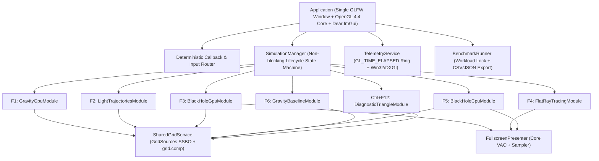

# Kiến trúc Tích hợp Black Hole vào GravitySim, Hồ sơ Tài nguyên & Kết quả Kiểm thử

Tài liệu kỹ thuật chính thức mô tả bản triển khai hợp nhất `quocthaile/black_hole` (`dc263bb5a1b72f5a24190d2e38b84b5c8fe9a317`) vào `quocthaile/gravity_sim` (nền `a5f9f930efaa828afa39ff79af00ed7b6add4ee1`) trên nhánh `feat/integrate_black_hole`.

---

## 1. Tổng quan Kiến trúc & Vòng đời Đơn Cửa sổ / Đơn Context

Ứng dụng hợp nhất `gravity_sim_3Dgrid` vận hành trên **một cửa sổ GLFW duy nhất** và **một OpenGL 4.4 Core Profile context duy nhất** xuyên suốt phiên làm việc. Executable đối chiếu lịch sử `gravity_sim_3Dgrid_baseline` (`src/gravity_sim_3Dgrid_baseline.cpp`) được giữ nguyên độc lập 100%, không chỉnh sửa.

### Vòng đời chuyển mode không chặn (`SimulationManager`)

Mọi yêu cầu chuyển mode (`F1`–`F6`, `Ctrl+F12`), đổi preset (`Tab`/`Shift+Tab`) hoặc reset runtime (`R`) đều đi qua máy trạng thái không chặn:

`Running -> Quiescing -> Releasing -> Loading -> Warmup -> Running` (và nhánh phục hồi `Loading -> Error -> Loading`).

1. **`Quiescing`**: Ngừng gửi công việc mới cho module cũ, gọi `BeginExit()` (gửi tín hiệu hủy `std::atomic<bool>` cho `CpuRayWorker` ở `F4`/`F5`, đóng các object đang `initializing` và flush CSV opt-in ở `F1`/`F6`), chèn hàng rào đồng bộ mới `GpuMemoryManager::CreateFreshFence()` (`glFenceSync` + `glFlush`) và kiểm tra không chặn mỗi frame qua `PollGpuCompletion()` + `IsReadyToRelease()`.
2. **`Releasing`**: Giải phóng toàn bộ tài nguyên riêng của scene cũ theo lô (`DestroyRoles`), hủy đăng ký khỏi `ResourceCensus`, đưa các binding GL về trạng thái sạch, tăng `sceneGeneration` và đặt lại `ScenePeak`.
3. **`Loading`**: Khởi tạo module đích trong khối an toàn ngoại lệ. Nếu thiếu tài nguyên hoặc lỗi shader/CSV, phần khởi tạo dở được dọn sạch ngay lập tức và chuyển sang `LifecycleState::Error` (UI vẫn phản hồi bình thường để người dùng chọn mode hợp lệ khác).
4. **`Warmup`**: Chạy các frame ổn định ban đầu trước khi gọi `TelemetryService::OnSceneGenerationChanged(sceneGeneration)` để xung thời gian tải scene không làm nhiễu biểu đồ steady-state FPS.

---

## 2. Phân quyền Sở hữu Tài nguyên (`ResourceCensus`)

| Nhóm sở hữu (`ownerTag`) | Vòng đời | Tài nguyên cụ thể | Chính sách |
| --- | --- | --- | --- |
| `shared:app` | Toàn phiên chạy | `GLFWwindow*`, OpenGL 4.4 Core context, Dear ImGui context | Tạo 1 lần trong `Application::Initialize`, hủy sau cùng trong `Application::Shutdown`. |
| `shared:shader_cache` | Toàn phiên chạy | Các `GLuint` program đồ họa & compute đã biên dịch | Biên dịch lười theo khóa định danh, giới hạn hữu hạn theo tập module, tái sử dụng qua các lần chuyển mode. |
| `shared:fullscreen_presenter` | Toàn phiên chạy | Core-profile empty `VAO` + `fullscreen_quad.{vert,frag}` | Giữ cố định để trình chiếu kết cấu đầu ra của `F3`, `F4`, `F5`. |
| `shared:grid` | Toàn phiên chạy | `BaseGrid` (SSBO 4), `DeformedGrid` (SSBO 5), `GridSources` (SSBO 1 theo pass), `gridVAO`, `gridEBO` | Giữ nguyên handle OpenGL xuyên suốt `F1 <-> F2 <-> F3 <-> F5 <-> F6` khi `divisions = 200` không đổi. |
| `shared:telemetry` | Toàn phiên chạy | Vòng truy vấn `GL_TIME_ELAPSED` (5 frame × 7 pass), `IDXGIAdapter3` | Gắn nhãn `sceneGeneration`; tự động bỏ kết quả trễ từ thế hệ scene cũ. |
| `scene:f1_gravity_gpu` | Theo mode `F1` | 8 object SSBOs (`CurrentState`, `NextState`, `ObjectPhysical`, `ObjectControl`, `ObjectDerived`, `ObjectAcceleration`, `ObjectRender`, `ObjectCollision`), `UnitSphere` VAO/VBO, `std::vector<Object> objs` | Giải phóng hoàn toàn 100% khi rời `F1`. Không giữ object SSBO giả cho các mode hố đen. |
| `scene:f2_trajectories` | Theo mode `F2` | `HorizonVAO/VBO`, `TrailsVAO/VBO`, `std::vector<PlanarRayState>`, `std::vector<BoundedTrailRing>` | Tách rời trạng thái RK4 khỏi ring buffer vết tia có sức chứa hữu hạn. Giải phóng khi rời `F2`. |
| `scene:f3_black_hole_gpu` | Theo mode `F3` | `GL_RGBA8` output texture, 3 `std140` UBOs (`Camera`, `Disk`, `Objects`) | Chỉ cấp phát lại texture khi độ phân giải compute hoặc trạng thái moving LOD thay đổi. Giải phóng khi rời `F3`. |
| `scene:f4_flat_raytracing` | Theo mode `F4` | `CpuRayWorker`, `GL_RGBA8` output texture, dữ liệu mặt cầu/nguồn sáng | Hủy & join worker an toàn trước khi xóa texture/bộ đệm CPU. |
| `scene:f5_black_hole_cpu` | Theo mode `F5` | `CpuRayWorker`, `GL_RGBA8` output texture, cấu hình đĩa bồi tụ/vật thể | Hủy & join worker an toàn; loại bỏ kết quả trễ khác `sceneGeneration` hoặc `cameraRevision`. |
| `scene:f6_gravity_baseline` | Theo mode `F6` | `CpuSphereInstanceVAO/VBO`, `UnitSphere` VAO/VBO, `std::vector<Object> bodies_` | Không cấp phát 8 object SSBOs của `F1`; đẩy nguồn lưới qua `SharedGridService::SetCpuSources`. |
| `scene:diagnostic_triangle` | Theo mode `Ctrl+F12` | `DiagTriangleVAO/VBO` (9 floats) | Giải phóng sạch khi rời chế độ chẩn đoán. |

---

## 3. Hợp đồng Binding Theo Pass & Đồng bộ Bộ nhớ (`glMemoryBarrier`)

Khe SSBO `binding = 1` được tái sử dụng **theo phạm vi từng pass** để tổng chỉ số SSBO tối đa không vượt quá giới hạn phần cứng đã kiểm chứng (`0..15`), và luôn được bind tường minh trước mỗi lệnh dispatch/draw:

| Pass | Shader Program | Bindings Đầu vào | Bindings Đầu ra | Đồng bộ sau Pass (`glMemoryBarrier`) |
| --- | --- | --- | --- | --- |
| `F1` N-Body Force | `shaders/nbody.comp` | SSBO `0` (`CurrentState`), `2` (`ObjectPhysical`), `3` (`ObjectControl`), `12` (`ObjectDerived`) | SSBO `13` (`ObjectAcceleration`), `15` (`ObjectCollision`) | `GL_SHADER_STORAGE_BARRIER_BIT` |
| `F1` Integration | `shaders/integrate.comp` | SSBO `0` (`CurrentState`), `3` (`ObjectControl`), `13` (`ObjectAcceleration`), `15` (`ObjectCollision`) | SSBO `1` (`NextState`) -> sau đó `SwapCurrentNext()` | `GL_SHADER_STORAGE_BARRIER_BIT` |
| `F1` Grid Materialization | `shaders/grid_sources.comp` | SSBO `0` (`CurrentState`), `12` (`ObjectDerived`) | SSBO `1` (`GridSources`) | `GL_SHADER_STORAGE_BARRIER_BIT` |
| Shared Grid Deformation | `shaders/grid.comp` | SSBO `1` (`GridSources`), `4` (`BaseGrid`) | SSBO `5` (`DeformedGrid`) | `GL_VERTEX_ATTRIB_ARRAY_BARRIER_BIT \| GL_SHADER_STORAGE_BARRIER_BIT` |
| Shared Grid Render | `shaders/grid.{vert,frag}` | `gridVAO` đọc `DeformedGrid` (VBO attr 0) + `gridEBO` | Default Framebuffer | Depth test theo cấu hình pass + Alpha blend |
| `F1` Object Render | `shaders/objects.{vert,frag}` | `UnitSphereVAO` + SSBO `0`, `12`, `14` (`ObjectRender`) | Default Framebuffer | Opaque instanced rasterization |
| `F2` Horizon & Trails | `shaders/trajectories/trail.{vert,frag}` | `HorizonVAO`, `TrailsVAO` (batched `GL_LINES` + `GL_POINTS`) | Default Framebuffer | 1 lần gọi batched draw cho toàn bộ vết tia |
| `F3` Geodesic Compute | `shaders/black_hole/geodesic_{rk4,legacy}.comp` | UBO `1` (`Camera`), UBO `2` (`Disk`), UBO `3` (`Objects`) | Image Unit `0` (`rgba8` writeonly) | `GL_SHADER_IMAGE_ACCESS_BARRIER_BIT \| GL_TEXTURE_FETCH_BARRIER_BIT` |
| `F3`/`F4`/`F5` Fullscreen Present | `shaders/fullscreen_quad.{vert,frag}` | Texture Unit `0` (`sampler2D`) + Empty Core `VAO` | Default Framebuffer | Depth test tắt trong pass phủ nền |
| `F6` CPU Instanced Render | `f6:cpu_objects_instanced` | `CpuSphereInstanceVAO` (UnitSphere attr 0 + Instance attr 1,2) | Default Framebuffer | Không chạm tới 8 SSBOs của `F1` |

---

## 4. Phím Điều khiển, Tham số Dòng lệnh & Các Chế độ Mô phỏng

### Phím tắt toàn cục (`GLFW_PRESS`, miễn nhiễm lặp phím `GLFW_REPEAT`)

| Phím | Chức năng |
| --- | --- |
| `F1` | Gravity N-Body (GPU Compute — Snapshot Pairwise Solver) |
| `F2` | Black Hole Light Trajectories (Planar Null Geodesics — 2D Ortho & 3D Orbit XZ + Shared Grid) |
| `F3` | Black Hole Lensing Image (GPU Compute — Canonical 4-Stage RK4 & Source-Compatible Legacy Euler) |
| `F4` | Flat-Space Ray Tracing (CPU Multi-Threaded Tile Worker — Baseline & Archive Variants) |
| `F5` | Black Hole Lensing Image (CPU Multi-Threaded Tile Worker — Geodesic RK4, Legacy Spherical & Geometric Silhouette) |
| `F6` | Historical CPU Gravity Baseline Adapter (`src/gravity_sim_3Dgrid_baseline.cpp` in-place physics trên hạ tầng Core Profile) |
| `Ctrl+F12` | Graphics Context Diagnostic (Tam giác cam Core Profile từ `src/legacy/3D_test.cpp`) |
| `Tab` / `Shift+Tab` | Chuyển preset kế tiếp / trước đó trong mode hiện tại |
| `G` | Bật / tắt lưới biến dạng không-thời gian 3D dùng chung (`SharedGridService`) |
| `P` | Tạm dừng / Tiếp tục mô phỏng (Camera và giao diện UI vẫn hoạt động mượt mà) |
| `N` | Tiến đúng 1 bước mô phỏng khi đang tạm dừng (`P`) |
| `R` | Đặt lại (Reset) trạng thái runtime của preset hiện tại |
| `C` | Đặt lại góc nhìn camera mặc định của mode hiện tại |
| `F7` | Ẩn / hiện bảng Telemetry HUD góc trên bên trái |
| `F8` | Mở / đóng cửa sổ tra cứu phím tắt |
| `F9` | Bắt đầu / Hủy lượt đo Benchmark |
| `F11` | Chuyển đổi Toàn màn hình (Fullscreen) / Cửa sổ (Windowed) |
| `Esc` | Đóng hộp thoại trợ giúp / nhả trạng thái giữ chuột-phím |
| `Q` | Đặt cờ thoát ứng dụng an toàn ở biên frame |

### Tham số dòng lệnh (`gravity_sim_3Dgrid.exe`)

- `--mode <F1|F2|F3|F4|F5|F6|diag>`: Chọn mode khởi động ban đầu.
- `--preset <index>`: Chọn chỉ số preset khởi động.
- `--asset-root <dir>`: Chỉ định thư mục gốc chứa `shaders/` (mặc định tự động dò theo đường dẫn thực thi `GetModuleFileNameW`, độc lập với thư mục làm việc CWD).
- `--width <px> --height <px>`: Kích thước cửa sổ khởi tạo.
- `--no-vsync`: Tắt VSync khi khởi động.
- `--hidden --smoke-frames <N>`: Chạy kiểm thử tự động `N` frame rồi thoát sạch.

---

## 5. Trạng thái Giải tích Số & Danh mục Solver (`Section 10` & `W8`)

Mọi solver trong hệ thống được gắn nhãn trạng thái xác thực tường minh, không trộn lẫn kết quả benchmark giữa hai mô hình toán học khác nhau:

1. **`rk4_canonical_v1` (`numerical_validated` — `F2`, `F3`, `F5`)**:
   - Phương trình đường trắc địa null chuẩn hóa không thứ nguyên quanh nghiệm Schwarzschild tĩnh ($\mathbf{u} = \mathbf{r}/r_s$, tham số affine quy chuẩn $h = \lambda / r_s$):
     $$\frac{d\mathbf{u}}{dh} = \mathbf{v}, \qquad \frac{d\mathbf{v}}{dh} = -\frac{3}{2}\frac{|\mathbf{u} \times \mathbf{v}|^2}{|\mathbf{u}|^5}\mathbf{u}$$
   - Khởi tạo vận tốc ánh sáng thỏa mãn chính xác ràng buộc null $|\mathbf{v}_0| = 1$ ở hệ quy chiếu phẳng tiệm cận, hoàn toàn không có kỳ dị tọa độ cực tại $\theta = 0, \pi$.
   - Đồng nhất phương trình giữa mặt phẳng xích đạo 2D (`F2`) và không gian 3D (`F3` GPU `geodesic_rk4.comp`, `F5` CPU `TraceBlackHoleRayCPU`).
   - Đã kiểm chứng hội tụ bậc $\approx 4$ bằng phép chia đôi bước (Richardson step-halving), bảo toàn chuẩn null $g_{\mu\nu}k^\mu k^\nu = 0$ và mô-men động lượng riêng trực tiếp từ tọa độ không gian pha, cùng kiểm thử đối chiếu pixel/quỹ đạo giữa CPU và GPU (`T13`).
2. **`euler_spherical_legacy_v1` (`source_compatible_legacy` — `F3`)**:
   - Bảo toàn nguyên trạng thuật toán trong `black_hole/geodesic.comp` gốc (hàm `rk4Step` trong mã nguồn gốc thực chất chỉ tính 1 lần vế phải Euler hiện trong hệ tọa độ cầu). Được đổi nhãn trung thực thành Euler 1-stage để phục vụ đối chiếu lịch sử, kèm sửa lỗi căn chỉnh bộ nhớ `std140` UBO.
3. **`rk4_planar_legacy_v1` (`source_compatible_legacy` — `F2`)**:
   - Bảo toàn hệ phương trình cực phẳng từ `2D_lensing.cpp`, nhưng đã tách `PlanarRayState` (trivially copyable) khỏi bộ đệm vòng `BoundedTrailRing` để loại bỏ chi phí sao chép lịch sử vết tia trong 4 bước RK4.
4. **`rk4_spherical_legacy_v1` & `geometric_silhouette_v1` (`source_compatible_legacy` — `F5`)**:
   - Tách bạch rõ hai chế độ của `CPU-geodesic.cpp` (`useGeodesics = true` tích phân cầu 3D và `useGeodesics = false` cắt hình học tia thẳng với mặt cầu chân trời sự kiện).
5. **`gpu_snapshot_euler_v1` (`source_compatible_legacy` — `F1`)** vs **`cpu_inplace_euler_baseline_v1` (`source_compatible_legacy` — `F6`)**:
   - Ghi rõ sự khác biệt ngữ nghĩa vật lý: `F1` cập nhật đồng thời từ snapshot toàn cục với làm mềm lực $\epsilon = 10\text{ m}$ và hệ số bước `dv += a/96`, `dx += v/94`; trong khi `F6` cập nhật tuần tự tại chỗ (vật `i` đổi vị trí ngay trước khi vật `i+1` tính lực), không có $\epsilon$ làm mềm, và nhân hệ số va chạm `-0.2` ngay trong vòng lặp cặp.

---

## 6. Sổ cái Kiểm kê Toàn diện Mã nguồn Lịch sử & Archive (Archival Coverage Ledger)

Bảng dưới đây phân loại đầy đủ 100% các tệp nguồn từ `quocthaile/black_hole:main`, các nhánh lịch sử (`ray_tracing`, `cool-versions`), toàn bộ **6 tệp `.cpp` trong `Gravity_Sim.zip`**, và thư mục `src/legacy/` của `gravity_sim` (tuyệt đối không sao chép các tệp nhị phân `.exe`/`.dll` cũ từ archive):

| Nguồn gốc & Đường dẫn Tệp | Phân loại Tích hợp | Nơi Tiếp nhận trong Kiến trúc Mới | Lý do & Ghi chú Kỹ thuật |
| --- | --- | --- | --- |
| `black_hole:main/2D_lensing.cpp` | **Active Module (`F2`)** | `LightTrajectoriesModule` + `black_hole_core.cpp` | Chuyển đổi từ immediate-mode (`glBegin`/`glOrtho`) sang OpenGL 4.4 Core batched VAO/VBO; khôi phục tia mẫu bị comment thành Preset 2 và bổ sung chùm tia song song & đẳng hướng. |
| `black_hole:main/black_hole.cpp` + `geodesic.comp` | **Active Module (`F3`)** | `BlackHoleGpuModule` + `shaders/black_hole/geodesic_{rk4,legacy}.comp` | Loại bỏ singleton `Engine` và hàm lưới CPU trùng lặp; sửa lỗi lệch byte `std140` (`bool`/scalar array); tách nhánh chuyển động `Gravity` thành tùy chọn thực nghiệm riêng (không chiếm phím `G`). |
| `black_hole:main/ray_tracing.cpp` | **Active Module (`F4` Preset 1)** | `FlatRayTracingModule` (Preset `f4_baseline_two_spheres`) | Dựng cảnh 2 mặt cầu phẳng với chiếu sáng ambient + diffuse + hard shadow trên `CpuRayWorker` đa luồng có hủy tác vụ. |
| `black_hole:main/CPU-geodesic.cpp` | **Active Module (`F5`)** | `BlackHoleCpuModule` | Tách thành 2 preset/solver rõ ràng: Geometric Silhouette và Full 3D Geodesic Trace; phát hiện OpenMP tùy chọn qua CMake và chạy an toàn trên `CpuRayWorker`. |
| `Gravity_Sim.zip -> Gravity_Sim/src/black_hole.cpp` | **Legacy Variant Adapted (`F4` Preset 2)** | `FlatRayTracingModule` (Preset `f4_archive_bh_flat_spheres`) | Thực chất là nguyên mẫu ray-tracing không gian phẳng với nguồn sáng điểm và mặt cầu phản xạ (chưa có metric Schwarzschild); được bảo tồn đúng bản chất vật lý trong `F4`. |
| `Gravity_Sim.zip -> Gravity_Sim/src/holding_file.cpp` | **Legacy Variant Adapted (`F4` Preset 3)** | `FlatRayTracingModule` (Preset `f4_archive_holding_emissive`) | Bảo tồn biến thể cảnh nhiều mặt cầu phát sáng/phản xạ đệ quy trong ray tracer phẳng `F4`. |
| `Gravity_Sim.zip -> Gravity_Sim/src/ray_tracing2.cpp` | **Legacy Variant Adapted (`F4` Preset 3/4)** | `FlatRayTracingModule` (Recursive Phong/Reflective shading) | Gộp chung cơ chế tia phản xạ đệ quy và góc nhìn camera thử nghiệm vào các preset archive của `F4`, tránh trùng lặp module. |
| `Gravity_Sim.zip -> Gravity_Sim/src/working_raytracing.cpp` | **Legacy Variant Adapted (`F4` Preset 4)** | `FlatRayTracingModule` (Preset `f4_archive_working_three_spheres_bounce`) | Bảo tồn cảnh 3 mặt cầu cùng tùy chọn chuyển động nảy trọng trường phẳng hằng số; không tự kích hoạt các nhánh `if(false)` chết. |
| `Gravity_Sim.zip -> Gravity_Sim/src/gravity_sim.cpp` | **Preset Imported (`F1` & `F6` Preset 3)** | `CreateLegacyThreeBodyObjects()` | Trùng họ điều kiện đầu 3 vật thể với `src/legacy/gravity_sim.cpp`; nhập điều kiện đầu vào Preset 3 của `F1` và `F6` với nhãn rõ ràng "Legacy Initial Conditions". |
| `Gravity_Sim.zip -> Gravity_Sim/src/gravity_sim_1.cpp` | **Duplicate / Early Prototype** | Ghi nhận trong sổ cái, không tạo mode thừa | Bản nháp trung gian sớm của vòng lặp N-body trước `gravity_sim_3Dgrid_baseline.cpp`, không chứa mô hình vật lý độc lập mới. |
| `black_hole:ray_tracing` (`b5519c7`) & `cool-versions` (`4382478`) | **Superseded Prototype Branches** | Đã bao phủ bởi `F4` & `F3` | Các nhánh thử nghiệm cũ trước `black_hole:main`; hành vi cốt lõi đã được đại diện đầy đủ qua `F4` và `F3`. |
| `gravity_sim/src/gravity_sim_3Dgrid_baseline.cpp` | **Untouched Reference + `F6` Adapter** | Target độc lập `gravity_sim_3Dgrid_baseline` + `GravityBaselineModule` (`F6`) | Tệp nguồn gốc giữ nguyên 100% byte-for-byte; thuật toán vật lý tại chỗ được đóng gói namespaced vào `F6`. |
| `gravity_sim/src/legacy/gravity_sim.cpp` | **Preset Imported (`F1` & `F6` Preset 3)** | `CreateLegacyThreeBodyObjects()` | Nhập bộ thông số 3 vật thể ban đầu vào `F1` và `F6`. |
| `gravity_sim/src/legacy/3D_test.cpp` | **Diagnostic Adapted (`Ctrl+F12`)** | `DiagnosticTriangleModule` | Chuyển thể sang quản lý vòng đời module chuẩn OpenGL 4.4 Core để chẩn đoán ngữ cảnh đồ họa. |

---

## 7. Nguồn gốc Mã nguồn & Giấy phép Thư viện Bên thứ ba (Provenance & Licenses)

- **Mã nguồn dự án**:
  - `quocthaile/gravity_sim` — base commit `a5f9f930efaa828afa39ff79af00ed7b6add4ee1`.
  - `quocthaile/black_hole` — imported commit `dc263bb5a1b72f5a24190d2e38b84b5c8fe9a317`.
- **Thư viện bên thứ ba** (quản lý qua `vcpkg.json` pin tại baseline `ffffe619563988cbcfda2b8db2c142654d12eaf5`):
  - **GLFW (`glfw3`)**: Giấy phép zlib/libpng.
  - **GLEW (`glew`)**: Giấy phép Modified BSD / MIT.
  - **GLM (`glm`)**: Giấy phép Happy Bunny / MIT.
  - **Dear ImGui (`imgui` với `glfw-binding`, `opengl3-binding`, bao gồm phông chữ mặc định ProggyClean nhúng sẵn)**: Giấy phép MIT (Copyright (c) 2014–2026 Omar Cornut).

---

## 8. Kết quả Kiểm thử Tự động CTest (`T01`–`T16`)

### Môi trường thực thi xác minh

- **Hệ điều hành**: Windows x64
- **Toolchain đã chạy thực tế**: MSYS2 UCRT64 `g++ 16.1.0` (`-std=c++20 -O3 -Wall -Wextra -fopenmp`), CMake `4.3.2`, Ninja `1.13.2`, `vcpkg` manifest (`x64-mingw-dynamic`). *(Ghi chú trung thực: Máy trạm hiện tại không cài đặt Visual Studio nên preset `msvc-*` được giữ sẵn cấu hình trong `CMakePresets.json`, còn toàn bộ quá trình build/kiểm thử thực tế trên máy được xác nhận bằng preset `msys2-gcc-release`).*
- **OpenGL Context thực tế**: `OpenGL 4.4.0 - Build 32.0.101.7077` (16 SSBO binding points `0..15`).
- **Trạng thái tệp tham chiếu gốc**: `git diff src/gravity_sim_3Dgrid_baseline.cpp` rỗng 100% (`gravity_sim_3Dgrid_baseline.exe` build độc lập thành công).

### Bảng kết quả 16/16 bài kiểm thử nghiệm thu (`100% Passed`)

| Mã Test | Mục tiêu Kiểm thử | Số liệu & Kết quả Thực tế | Trạng thái |
| --- | --- | --- | --- |
| `T01_GravityGpuParity` | Đối chiếu `F1` preset mặc định (`2+200`, seed `123`) với CPU snapshot oracle | `maxPosErr = 4.88e-4` world units, `maxVelErr = 1.53e-5` world/step | **PASS** |
| `T02_SharedGridSourcesAndZeroObjectRoles` | Lưới biến dạng với `0`, `1` (SagA*), và `4` nguồn khi đã xóa sạch 8 object SSBOs | `0` nguồn cho lưới phẳng tuyệt đối; `1` và `4` nguồn khớp giải tích `< 1e-2` | **PASS** |
| `T03_SingleContextAndGridHandleInvariance` | Chuỗi `F1 -> F2 -> F3 -> F2 -> F1` trên cùng cửa sổ/context | Pointer `GLFWwindow*`/context và 5 handle GL của `SharedGrid` bất biến 100% | **PASS** |
| `T04_AllModePairsAndPresetResets` | Chuyển đổi toàn bộ các cặp mode `F1..F6` + `Ctrl+F12`, `Tab` preset, `R` reset, `C` camera | Giữ đúng preset đã nhớ theo từng mode, không lỗi GL (`GL_NO_ERROR`) | **PASS** |
| `T05_KeyRepeatIgnoreAndCoalescing` | Bỏ qua `GLFW_REPEAT` và gộp chuỗi nhấn nhanh `F2..F6..F2` | 25 sự kiện `GLFW_REPEAT` gây `0` lần nạp lại; chuỗi 6 phím gộp đúng `1` lần nạp | **PASS** |
| `T06_ExitDuringInitializingPausedAndExport` | Chuyển mode khi đang giữ tạo vật thể `initializing`, `paused` và bật CSV v2 | Vật thể dở được thu hồi sạch; tệp CSV `schema_version=2` ghi đúng `scene_generation` & `Object::id` | **PASS** |
| `T07_CpuWorkerCancellationAndStaleDrop` | Hủy `CpuRayWorker` đang render dở ở `F4`/`F5` khi đổi camera & chuyển mode | Worker dừng an toàn không treo UI, kết quả thế hệ cũ bị loại bỏ | **PASS** |
| `T08_ResizeFullscreenMinimizeZeroByZeroGuard` | Thu nhỏ cửa sổ `0x0` (minimize) và khôi phục/đổi kích thước | Không cấp phát texture `0x0`; khôi phục `1280x720` -> `1024x768` sạch | **PASS** |
| `T09_FiftyCycleStressResourceCensusBounded` | 50 vòng chuyển mode liên tục sau warm-up | Sau warm-up: `29` live objects (`2,011,168` bytes); sau 50 vòng: đúng `29` live objects (`2,011,168` bytes — rò rỉ `0` byte) | **PASS** |
| `T10_InitFailurePartialCleanupAndErrorRecovery` | Lỗi khởi tạo module / thiếu tệp CSV giữa chừng `OnEnter` | Giải phóng sạch tài nguyên tạo dở (`LiveSceneResourceCount == 0`), vào `Error` và phục hồi lại `F1`/`F2` bình thường | **PASS** |
| `T11_PausedGridDirtyAndSharedBlackHoleSync` | Đổi khối lượng hố đen khi đang `paused` & ẩn lưới; chuyển `F2 -> F3` | Trì hoãn dispatch khi lưới ẩn; tính đúng 1 lần khi hiện lại; `F3` nhận cùng `rs` và tái sử dụng lưới | **PASS** |
| `T12_BenchmarkConfigLockAndMutationAbort` | Khóa cấu hình benchmark, xuất CSV/JSON manifest và tự động `Aborted` khi đổi camera/mode | Xuất đầy đủ CSV (`schema_version=1`) & JSON manifest chứa SHA nguồn; đổi camera/mode chuyển ngay sang `Aborted` | **PASS** |
| `T13_GeodesicConvergenceInvariantsAndCpuGpuParity` | Hội tụ RK4, bảo toàn chuẩn null & mô-men động lượng, đối chiếu 2D/3D và CPU vs GPU `F3` | Bậc hội tụ thực nghiệm **`p = 3.9675`** ($\approx 4$); sai số null **`1.33e-11`**, mô-men động lượng **`6.11e-12`**; tương đồng ảnh `64x48` CPU vs GPU đạt **`100%`** | **PASS** |
| `T14_F2BoundedTrailsSingleDrawZeroTrailCopy` | `F2` chạy dài hạn (1,280 bước affine > dung lượng vòng 1,024), kiểm tra copy RK4 & số draw call | `static_assert(is_trivially_copyable_v<PlanarRayState>)`; bộ nhớ vết tia không vượt trần; tổng số draw call scene $\le 6$ | **PASS** |
| `T15_ExternalWorkingDirectoryAssetResolution` | Khởi chạy từ thư mục rỗng bên ngoài (`%TEMP%`) nạp shaders & CSV preset | Tự động định vị `shaders/` qua đường dẫn executable và chạy sạch `F1` (CSV), `F2`, `F3` | **PASS** |
| `T16_HistoricalBaselineCpuPhysicsParity` | Đối chiếu 120 bước vật lý `F6` với thuật toán gốc `gravity_sim_3Dgrid_baseline.cpp` | `maxPosDiff = 0`, `maxVelDiff = 0` (khớp tuyệt đối bit-exact) | **PASS** |

