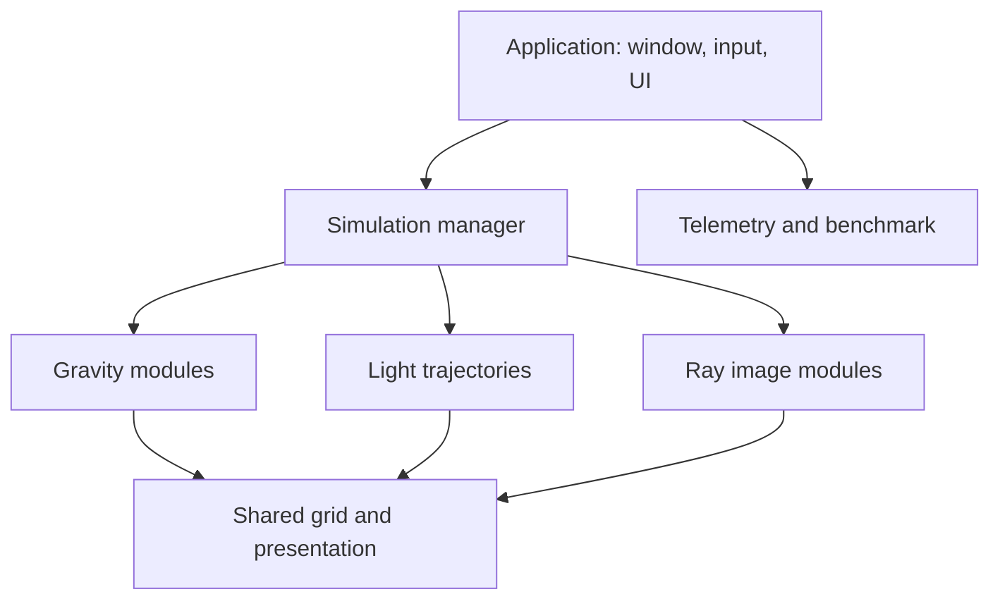
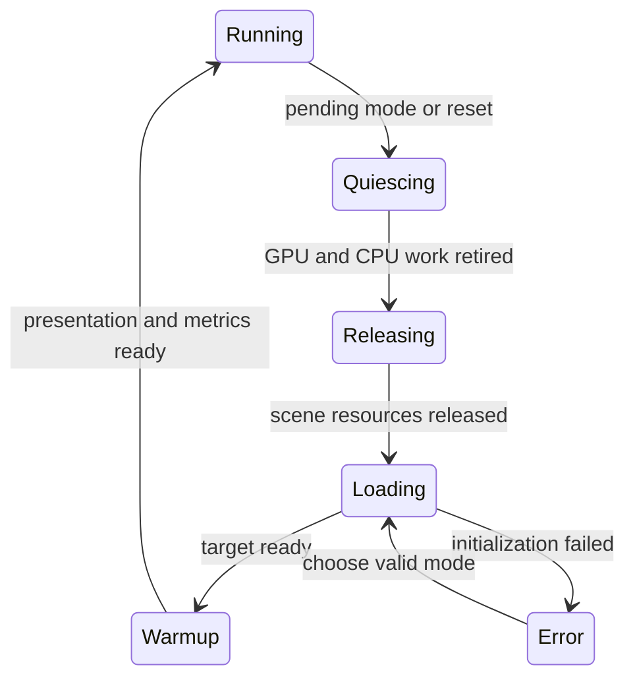

# Kế hoạch tích hợp Black Hole vào GravitySim

Ngày lập: **29/10/2026 — Asia/Bangkok**. Trạng thái: **kế hoạch đề xuất, chưa triển khai**.

Mục tiêu: một ứng dụng Windows dùng chung cửa sổ/OpenGL context, chuyển mô hình bằng phím tắt, hiển thị theo phong cách phần mềm benchmark, giải phóng runtime resources của mô hình cũ và giữ hạ tầng dùng chung, đặc biệt lưới deform.

## 1. Nền mã nguồn và phạm vi xác minh

| Repository/ref | Commit được kiểm tra | Vai trò |
| --- | --- | --- |
| `quocthaile/gravity_sim:perf/optimize_memory_layout` | `a5f9f930efaa828afa39ff79af00ed7b6add4ee1` | Nền triển khai đề xuất; commit ngày 28/10/2026 23:57:33 +07:00. |
| `quocthaile/gravity_sim:main` | `c98dcd55958420b88e6c5193e954e71ee3f8b574` | Default branch; nhánh trên ahead 3 commit, behind 0 tại lúc kiểm tra. |
| `quocthaile/black_hole:main` | `dc263bb5a1b72f5a24190d2e38b84b5c8fe9a317` | Nguồn chính để trích module black-hole, lensing và ray tracing. |

“Commit mới nhất” trong kế hoạch này là HEAD của nhánh phát triển `perf/optimize_memory_layout` đã fetch và kiểm tra, không đồng nhất với HEAD `main`. Khi bắt đầu coding phải kiểm tra remote HEAD lại; nếu thay đổi, rebase kế hoạch theo diff và chạy lại kiểm tra nền.

Đã thực hiện: đọc mã nguồn, CMake, tài liệu, các remote ref và danh sách source trong archive. Chưa thực hiện: build ứng dụng, chạy GPU validation, đo FPS/CPU/GPU/RAM/VRAM, hoặc sửa mã nguồn repository. Mọi con số mục tiêu kiểm thử trong tài liệu là tiêu chí đề xuất; không phải kết quả đã đo.

Các thay đổi quan trọng của nền hiện tại:

- `ComputeUniformLocations` và `InitializeComputeUniformLocations()` đã có; giữ cơ chế cache này.
- `CaptureGpuTrajectorySample()` hiện là hàm được khai báo trong header và triển khai trong function module; không còn là lambda trong `main()`.
- Validation harness nằm tại `src/legacy/gravity_sim_3Dgrid_phase2_validation.cpp`; CMake hiện không còn đăng ký target/CTest cho harness này.
- `Cleanup()` hiện hủy cả grid, mọi buffer/program và gọi `glfwTerminate()`. Không thể dùng nguyên hàm này cho việc đổi mô hình mà vẫn giữ cửa sổ/lưới.
- `grid.comp` hiện đọc `CurrentState` ở SSBO binding 0 và `ObjectDerived` ở binding 12. Chỉ xóa object buffers rồi tiếp tục dispatch grid sẽ phá hợp đồng dữ liệu.

## 2. Quyết định kiến trúc

1. Dùng **một GLFW window và một OpenGL 4.4 core context** trong toàn bộ phiên chạy.
2. Ứng dụng sở hữu event loop, UI, presentation, telemetry và scene switching. Module không tự tạo window/context hoặc gọi `glfwTerminate()`.
3. Module chứa solver, state và tài nguyên riêng. Kết thúc module sẽ retire workload rồi release tài nguyên riêng.
4. Grid trở thành service dùng chung, nhận danh sách nguồn khối lượng độc lập với N-body runtime.
5. Chuyển mô hình mặc định giữ cấu hình/preset/camera; runtime đang tiến hóa được giải phóng. Quay lại mô hình sẽ dựng lại initial state. Resume chính xác state cũ cần snapshot riêng, chưa là hành vi mặc định.
6. Tách **mô hình**, **preset**, **backend**, **solver version** và **visualization options** trong cấu hình và HUD.
7. Import/refactor và sửa numerical model là các commit/thí nghiệm riêng. Mỗi kết quả benchmark ghi solver/version đang chạy.
8. Link module vào cùng executable qua CMake targets. Dynamic DLL/plugin ABI không nằm trong lần tích hợp đầu.



Tên component/API mới trong các phần sau đều là **đề xuất**, trừ những tên đã được xác nhận là có trong mã nền. Không được ghi chúng là implemented trước khi có commit và kiểm thử tương ứng.

## 3. Danh mục mô hình và kịch bản

### 3.1. Các mode của ứng dụng

| Phím đề xuất | Mode | Nguồn thực tế | Công việc tích hợp |
| --- | --- | --- | --- |
| `F1` | Gravity N-body GPU | `src/gravity_sim_3Dgrid.cpp`, function module, `nbody.comp`, `integrate.comp`, object shaders | Adapter quanh pipeline hiện có; giữ GPU authority và cached uniforms. |
| `F2` | Tia sáng bay ngang black hole, có trajectory/trail | `black_hole/2D_lensing.cpp` | Trích planar geodesic state/RK4; viết renderer VAO/VBO/shader cho core profile; tạo ray preset rõ ràng. |
| `F3` | Black-hole image GPU | `black_hole.cpp` + `geodesic.comp` | Trích compute/image pass, camera/disk/object data; dùng window, grid và presentation chung. |
| `F4` | Ray tracing CPU trong flat space | `ray_tracing.cpp` | Trích sphere intersections, shading và pixel renderer; giữ tách biệt với gravitational lensing. |
| `F5` | Black-hole image CPU | `CPU-geodesic.cpp` | Trích ray solver và renderer; CPU worker có cancellation; phân biệt silhouette hình học và geodesics. |
| `F6` | Historical CPU gravity adapter | `src/gravity_sim_3Dgrid_baseline.cpp` | Trích CPU physics thành adapter namespaced; giữ executable gốc riêng làm historical reference. Rendering tích hợp dùng hạ tầng chung nên phải ghi đây là adapter, không phải FPS nguyên bản. |
| `Ctrl+F12` | Graphics diagnostic | `src/legacy/3D_test.cpp` | Tam giác kiểm tra graphics/context; thuộc diagnostics, không gọi là mô phỏng vật lý. |

Tên hiển thị mode có thể viết dễ đọc; tên source/class/function gốc giữ nguyên trong phần provenance và tài liệu kỹ thuật. Nếu cần loại bỏ xung đột tên `Ray`, `Object`, `Engine`, `Camera`, dùng namespace riêng cho từng module và mô tả mapping. Không link thẳng nhiều file có `main()` và global singleton vào cùng executable.

### 3.2. Preset và submode có trong source

| Mode | Nội dung từ mã | Policy đề xuất |
| --- | --- | --- |
| F1 | Hai object mặc định và 200 random orbiters, seed `123` | Preset default tương ứng source hiện tại. |
| F1 | Hai object mặc định khi `randomObjectCount = 0` | Preset cấu hình từ hàm `CreateObjects()` hiện có; không gọi là preset đã có UI. |
| F1 | Load object từ file qua `CreateObjects(objectFilePath, ...)` | Thêm UI/CLI chọn file; kiểm tra dữ liệu, đường dẫn và lỗi. |
| F1 | Ba object active trong `src/legacy/gravity_sim.cpp` | Chuyển initial conditions sang preset của engine mới; nhãn “legacy initial conditions”. Cùng input không bảo đảm quỹ đạo giống legacy solver. |
| F2 | Có solver và trail trong `2D_lensing.cpp`, nhưng vector `rays` đang rỗng; dòng tạo ray duy nhất bị comment | Tạo preset mới từ ví dụ được comment và các impact parameter được ghi lại; phân biệt cấu hình đề xuất với behavior hiện chạy. |
| F3 | Static scene, disk và các object từ `black_hole.cpp` | Default black-hole GPU scene. |
| F3 | Nhánh chuyển động object điều khiển bởi `Gravity` | Lưu thành legacy experimental submode; nút mới không dùng `G` vì `G` dành cho grid. Kiểm tra riêng vì metric trung tâm đang hard-coded/tĩnh. |
| F4 | Hai sphere và ambient/diffuse/shadow logic | Preset baseline flat-space ray tracing; không quảng cáo các field material chưa được solver sử dụng là hiệu ứng đã có. |
| F5 | `useGeodesics = false` và `true` | Hai submode: geometric silhouette và CPU geodesics, chọn bằng preset/submode UI. |
| F6 | CPU baseline với original force/update/collision order | Đối chiếu solver riêng; không dùng mặc định để khẳng định speedup GPU cùng bài toán nếu semantics khác. |

`Tab`/`Shift+Tab` chuyển preset của mode đang active. Các preset có mã định danh ổn định, initial conditions và revision; không dựa vào thứ tự menu để ghép kết quả.

### 3.3. Source lịch sử và archive

Các nhánh `black_hole:ray_tracing` (`b5519c7...`) và `cool-versions` (`4382478...`) cũ hơn `main`, không phải nguồn “latest”. Chúng có các bản prototype ray tracing. Không merge toàn nhánh hoặc gọi toàn bộ chúng là model mới.

`Gravity_Sim.zip` trong black-hole repository chứa sáu `.cpp`:

| File trong archive | Cách đưa vào kế hoạch |
| --- | --- |
| `Gravity_Sim/src/black_hole.cpp` | Kiểm kê ray-traced objects, light/material và update law; nếu giữ lại thì tạo legacy variant có provenance. Không đồng nhất với Schwarzschild shader hiện tại chỉ dựa vào filename. |
| `Gravity_Sim/src/gravity_sim.cpp` | Đối chiếu initial conditions/update law với legacy gravity; nhập phần cấu hình khác biệt thành preset. |
| `Gravity_Sim/src/gravity_sim_1.cpp` | Kiểm tra vai trò prototype/diagnostic; không tự đặt thành một model vật lý mới. |
| `Gravity_Sim/src/holding_file.cpp` | Kiểm kê các ray-tracing scene/material và hành vi cập nhật khác biệt trước khi nhập. |
| `Gravity_Sim/src/ray_tracing2.cpp` | So sánh camera, sphere scene và shading với F4; giữ khác biệt có giá trị dưới legacy variant. |
| `Gravity_Sim/src/working_raytracing.cpp` | Có ba sphere và các đoạn cập nhật chuyển động/bounce; port thành legacy variant nếu muốn giữ behavior; không kích hoạt các đoạn `if(false)` như thể vốn là behavior active. |

Work package cuối phải có coverage ledger cho từng source: duplicate, diagnostic, preset imported hoặc legacy behavior adapted, kèm lý do. Nội dung archive mới được kiểm kê, chưa được xác nhận build hoặc numerical correctness. Không chạy/copy các `.exe`, `.dll` và project build artifacts có sẵn trong archive vào bản phát hành.

## 4. Giao diện và input kiểu phần mềm benchmark

### 4.1. Chế độ hiển thị

- **Interactive:** viewport lớn; tên model/preset/backend/solver; HUD compact; panel cấu hình có thể ẩn; camera và phím tắt hoạt động.
- **Benchmark:** cấu hình, camera path, workload và VSync bị khóa theo run; warm-up, measuring, completed/aborted hiển thị rõ; overlay overhead được ghi nhận.
- **Diagnostics:** GPU/context/driver, resource ownership, allocation counters, active bindings theo pass, numerical status và lỗi.

Đề xuất thêm Dear ImGui bằng backend `imgui_impl_glfw` và `imgui_impl_opengl3`; đây là dependency mới. Pin phiên bản/commit và ghi license. Không chuyển framework cửa sổ sang Qt trong lần tích hợp này. ImPlot hoặc một chart library khác không bắt buộc; đồ thị frame time đơn giản đủ cho V1.

Thông tin ở HUD: tên mode và preset; backend; solver/version; FPS và frame time; CPU submission time; GPU pass times; object/ray count; image/grid resolution; pause/benchmark status. CPU/RAM/GPU utilization nằm trong telemetry panel để HUD không chiếm viewport.

### 4.2. Phím điều khiển chung

| Phím | Hành động | Ghi chú |
| --- | --- | --- |
| F1–F6 | Đề nghị chuyển mode | Chỉ xử lý `GLFW_PRESS`; giữ phím không lặp việc load/unload. |
| Tab / Shift+Tab | Preset kế / trước | Bỏ qua khi UI đang nhập text; transaction chuyển preset dùng cùng cơ chế lifecycle. |
| G | Bật/tắt grid | `G` trong source black-hole cũ phải chuyển sang action riêng. |
| P | Pause/resume model update | Camera/UI tiếp tục phản hồi; static ray image không có physical time để pause. |
| N | Một bước khi pause | Gravity: một model step; F2: một affine step; image model: một evaluation theo cấu hình. |
| R | Reset runtime của preset | Không reset context; reset có giữ camera theo cấu hình. |
| C | Reset camera của mode | Mỗi mode có camera defaults riêng. |
| F7 | HUD on/off | Ghi trạng thái HUD vào benchmark manifest. |
| F8 | Help/phím tắt | Bảng phím luôn có thể mở từ menu. |
| F9 | Start/stop benchmark | Nếu mode switch đang diễn ra thì disable. |
| F11 | Windowed/fullscreen | Dùng chính window; resize event đi qua application. |
| Ctrl+F12 | Diagnostic triangle | Scene riêng, cũng dùng resource lifecycle. |
| Esc | Thoát mouse capture/đóng panel | Không tự hủy context từ callback. |
| Q | Yêu cầu quit khi viewport có focus | Chỉ đặt trạng thái pending quit; application cleanup ở vòng lặp chính. |

Giữ W/A/S/D, Space và Left Shift cho free camera của Gravity; không dùng Space làm pause. Input liên tục được đọc mỗi frame từ key state. Input đổi mode/preset dùng sự kiện press. Hold-K pause của source cũ có thể giữ như compatibility action có thể cấu hình, nhưng phải loại bỏ logic tự set `pause=false` trên mọi key callback khi K không được giữ.

Camera orbit/pan của black-hole và camera orthographic của planar rays là hai controller khác nhau. UI/HUD nêu controls của mode active. Chỉ module active nhận input mô phỏng; app callbacks trỏ tới application sống lâu, không trỏ trực tiếp tới object camera của module sắp bị hủy.

Callback GLFW chuyển event cho UI và action router; xét `WantCaptureMouse`/`WantCaptureKeyboard` trước khi gửi action cho scene. Mouse release/focus loss vẫn phải xóa trạng thái hold nội bộ để không kẹt drag/key. Không thay key callback mỗi frame.

## 5. Ownership và phân nhóm tài nguyên

### 5.1. Giữ đến khi thoát ứng dụng

| Nhóm | Nội dung | Policy |
| --- | --- | --- |
| Application | GLFW window/context, GLEW initialization, UI context/backend, event router | Khởi tạo một lần, hủy cuối cùng. |
| Presentation | Fullscreen primitive VAO/VBO, scene target/FBO dùng chung nếu kích thước phù hợp | Giữ; resize theo framebuffer thực. |
| Shader cache | Programs và uniform location caches được compile lazy theo mode | Cache bounded theo danh sách module. Program và cache location cùng lifetime; relink thì invalidate locations. |
| Telemetry | Ring buffers, query pools, system-provider handles, benchmark recorder | Giữ; phân tách dữ liệu theo scene generation và run. |
| Shared grid | Grid VAO/EBO, BaseGrid, DeformedGrid, GridSources đề xuất, grid programs/config | Giữ khi đổi mode nếu topology/layout còn phù hợp. |

### 5.2. Release khi rời mode

| Mode | Tài nguyên riêng cần release |
| --- | --- |
| Gravity GPU | CPU `objs`; CurrentState, NextState, ObjectPhysical, ObjectControl, ObjectDerived, ObjectAcceleration, ObjectCollision, ObjectRender; sphere mesh nếu đã chọn không cache mesh; counters/materialization maps; trajectory recorder của session. |
| Light trajectories | Solver states, trails/history; point/line/horizon VAO/VBO/IBO; pending trajectory jobs; counters. |
| Black Hole GPU | Camera/Disk/Objects UBO hoặc representation thay thế; ray output texture/image; ray buffers/counters; pending scene jobs. |
| Flat ray tracing CPU | Worker/job state, scene materials/objects, pixel buffers, upload/texture resources riêng. |
| Black Hole CPU | Worker/job state, ray/pixel buffers và output texture riêng; không dùng chung mutable globals với GPU module. |
| Gravity baseline adapter | CPU physics state và bất kỳ geometry/upload resources riêng; không gọi cleanup của executable gốc. |

Shader cache được giữ có chủ đích và phải được tính vào memory report. Release `std::vector::clear()` chỉ xóa phần tử, không bảo đảm trả capacity; nếu yêu cầu trả bộ nhớ khi rời mode thì hủy owner/container hoặc swap với container rỗng sau khi worker đã dừng. Tương tự, CPU pointer từ persistent mapping trở thành invalid sau release; mọi view/cache pointer phải bị xóa trước khi buffer owner bị hủy.

### 5.3. Thay đổi bắt buộc với các hàm hiện có

| API hiện có | Vai trò sau refactor |
| --- | --- |
| `StartGLU()` | Application initialization; kiểm tra kết quả và capability trước khi tạo scene. |
| `CreateShaderProgram()` | Tách chương trình grid/object/gravity; không mặc định tạo mọi program khi chỉ chạy ray mode. |
| `ComputePipeline()` | Tách khởi tạo grid memory và object memory; không yêu cầu có 8 object roles chỉ để vẽ grid. |
| `RunObjectStateSync()` | Chỉ gọi khi Gravity GPU active và object state đã tồn tại. |
| `RunGpuStateTransition()` | Giữ semantics ban đầu trong giai đoạn import; bind đầy đủ roles của pass trước khi gọi. |
| `RunGridCompute()` | Đọc GridSources mới; đổi uniform source count và cập nhật cache location theo shader mới. |
| `CaptureGpuTrajectorySample()` | Chỉ hoạt động trong Gravity session hợp lệ; observation có chủ đích, không auto gọi ở mọi mode. |
| `Cleanup()` | Tách module release, shared-grid shutdown và application shutdown. Không gọi nguyên hàm ở F1→F2. |
| `GpuMemoryManager::Destroy()` | API hiện có dùng được cho một role; thêm batch release theo owner/group để có một quiescence point và accounting rõ ràng. |
| `GpuMemoryManager::Shutdown()` | Chỉ dùng shutdown toàn application/shared owner tương ứng; không dùng cho scene switch nếu grid nằm chung manager. |

## 6. Tách grid khỏi object và giữ deform theo black-hole mass

### 6.1. Hợp đồng dữ liệu đề xuất

Grid cần vị trí nguồn và Schwarzschild radius, không cần toàn bộ state/collision/render data của N-body. Thêm record shader/host tương ứng, tên đề xuất `GridSource`:

```cpp
// ĐỀ XUẤT; chưa tồn tại ở commit nền.
struct GridSource {
    glm::vec4 positionRs; // xyz: scene world units; w: rs in meters
};
```

Host/shader phải kiểm tra size/offset/stride. Một `BlackHoleParameters` đề xuất giữ mass kg, position trong frame được định nghĩa, rs tính từ `2*G*M/(c*c)` bằng double, cùng revision. Cả F2, F3, F5 và grid lấy từ source này. Không giữ một fake N-body `Object` hoặc 8 object buffers chỉ để cung cấp black-hole mass cho grid.

### 6.2. Đường dữ liệu

- **F1:** sau integration và ping-pong, một materialization compute pass đọc CurrentState mới + ObjectDerived và ghi GridSources. Giữ dữ liệu GPU→GPU; không gọi `CaptureGpuTrajectorySample()` để nuôi grid.
- **F2/F3/F5:** application upload một GridSource từ shared BlackHoleParameters khi mass/position/frame thay đổi. Solver state của tia và N-body object hoàn toàn độc lập.
- **F4/diagnostic:** grid off mặc định. Nếu bật một grid trang trí hoặc giữ black-hole background, ghi rõ source/ý nghĩa của grid; không giả định sphere vật liệu của flat ray tracer là các nguồn khối lượng vật lý.
- **Không có source:** đặt source count bằng 0 và dispatch để tạo grid phẳng khi cần; không giữ output cũ ngoài ý định của scene.

Đề xuất thêm `BufferRole::GridSources` và cập nhật docs/inspection/accounting. Không tự chọn binding 16 vì nền đang kiểm tra đến binding 15; thêm slot cao có thể làm tăng yêu cầu phần cứng. Một layout khả thi sử dụng lại binding 1 **theo pass**:

| Pass | SSBO inputs | SSBO output |
| --- | --- | --- |
| N-body/integration | Các binding hiện có | NextState ở 1 và các role hiện có |
| Grid-source materialization mới | CurrentState 0, ObjectDerived 12 | GridSources 1 |
| Grid deformation mới | GridSources 1, BaseGrid 4 | DeformedGrid 5 |
| Object render | CurrentState 0, ObjectDerived 12, ObjectRender 14 | Framebuffer |

Binding 1 có nghĩa khác nhau theo pass; `NextState` phải bind lại trước integration sau đó. Đây là **thay đổi có kiểm thử của binding contract**, không dựa vào global bindings còn sót. UBO binding 1 của camera black-hole thuộc namespace UBO khác với SSBO binding 1, nên không tự xung đột chỉ vì trùng số. Tuy nhiên mỗi pass vẫn phải bind tài nguyên nó dùng.

Nếu chọn implementation khác cho binding layout khi coding, phải giữ nguyên các invariant: không tăng capability ngoài ý định; không overwrite buffer input; đầy đủ rebind trước consumer; cập nhật validation và docs cùng commit.

### 6.3. Cache và dirty state

Giữ BaseGrid, grid topology và DeformedGrid khi topology không đổi. Đặt grid dirty khi nguồn, source count, grid geometry/plane, world-unit scale hoặc deformation parameters thay đổi. Camera view thay đổi thông thường chỉ cần cập nhật view/projection; không đòi hỏi tính lại deformation nếu grid không camera-dependent.

- F1 đang tiến hóa: source revision tăng mỗi model step, grid có thể cần cập nhật theo policy đã chọn.
- F1 pause, không chỉnh object: có thể reuse output.
- F2→F3 hoặc F3→F5: nếu cùng BH mass/position và grid config thì giữ cả deform output; chỉ thay camera/render pass theo mode.
- F1→F2: giữ allocation/topology, thay nguồn nhiều body bằng BH source và tính lại deform một lần. Không giữ nguyên hình dạng deformation của scene F1 nếu nó không khớp nguồn F2.
- Grid hidden: có thể trì hoãn compute nhưng giữ dirty flag; khi bật phải cập nhật trước khi draw.

### 6.4. Scale và công thức visualization

Grid hiện có `distance * 1000.0` và hệ số visualization `2.0e11`. Không mang nguyên giá trị này vào một scene đã chuẩn hóa theo rs mà không kiểm tra scale.

Đề xuất cấu hình rõ `metersPerWorldUnit`, `gridExtentWorld`, `basePlaneOffsetWorld`, `deformationAmplitudeWorld`. Công thức visual cùng họ với hiện tại có thể tham số hóa:

\[
\Delta h_{world}=-A_{world}\sum_i\frac{r_{s,i}}{\max(r_{i,m},(1+\delta)r_{s,i})}.
\]

Trong đó khoảng cách và rs cùng đơn vị mét, A có world units. Preset Gravity compatibility giữ scale/hệ số nguồn hiện tại. BH modes chọn cùng scale cho camera, horizon, trails và grid, ví dụ dùng rs làm đơn vị world sau khi kiểm thử visual fit. Giá trị A cuối cùng là tham số visualization được ghi trong preset, không là kết quả suy ra từ metric.

Lưới là visualization. Nó không thay gravitational force solver và không tự đại diện chính xác geometry của mọi model. Đường tia phải được tích phân bởi geodesic equations, không bẻ cong bằng gradient của lưới visual.

## 7. Vòng đời chuyển mode



Quy trình một transaction:

1. Callback chỉ ghi `pendingMode/preset` qua action router. Không delete tài nguyên, gọi `glfwTerminate()` hay đổi context trong callback.
2. Ở frame boundary, ngừng submit workload mới của mode cũ; hoàn tất/abort benchmark run theo policy; đánh dấu snapshot/export đang pending.
3. Request cancellation của CPU worker. Mọi worker job mang scene generation; kết quả cũ không được publish vào mode mới.
4. Tạo **fresh GPU fence sau lệnh cuối của mode cũ**. Fence cũ tạo trước workload cuối không đủ chứng minh completion. Bảo đảm fence đã được submit bằng `glFlush()` một lần hoặc flush flag phù hợp ở lần client wait đầu; poll completion và tiếp tục poll input. API `WaitForGpuCompletion()` hiện có vòng wait blocking nên cần thêm đường poll/non-blocking cho state Switching. Giới hạn workload để một dispatch không chặn giao diện quá lâu.
5. Sau khi CPU không còn dùng scene memory và GPU quiescent, release tài nguyên riêng; invalidate mapped views, callbacks/data views, query ownership và scene pointers. Batch release tránh lặp một fence/wait dài cho từng role.
6. Reset GL state/bindings theo pass contract; giữ application, shader cache và shared grid. Lưu cấu hình/camera/preset, không giữ runtime state nếu chưa chọn snapshot policy.
7. Tạo target module, apply preset/units/solver/camera; tạo tài nguyên riêng. Grid service cập nhật source/config và dirty state.
8. Render frame đầu, thực hiện warm-up nếu benchmark; reset frame-time window để mẫu switching/loading không trộn với steady state.
9. Chỉ công bố `activeMode` mới sau khi initialization thành công. Nếu lỗi, release phần tạo dở, đưa app vào error/selection state còn dùng được.

Một mode request trùng active mode là no-op; R mới là reset. Nhiều F-key liên tục được coalesce thành request mới nhất; transaction đang release phải hoàn thành nhất quán trước transaction sau. Không có yêu cầu hard real-time hoặc thời gian switch cố định trước khi đo.

Việc GL có thể trì hoãn xóa object còn được dùng là một phần API semantics, nhưng application vẫn phải quản lý lifetime của mapped pointers, CPU workers và registry. Không dùng một `glFinish()` trong mọi frame làm giải pháp chung. Khi context/driver lỗi hoặc fence wait failed, báo lỗi và xử lý application state; không truy cập tài nguyên chưa chắc còn hợp lệ.

### 7.1. Đồng bộ giữa các pass

| Producer → consumer | Đồng bộ cần đặc tả trong implementation |
| --- | --- |
| N-body ghi acceleration/collision → integration đọc SSBO | `GL_SHADER_STORAGE_BARRIER_BIT`. |
| Integration ghi NextState → đọc state mới cho source materialization/object rendering | `GL_SHADER_STORAGE_BARRIER_BIT`; swap/rebind role đúng trước consumer. |
| Materialization ghi GridSources → grid deformation đọc SSBO | `GL_SHADER_STORAGE_BARRIER_BIT`. |
| Grid ghi DeformedGrid → grid VAO vertex fetch | `GL_VERTEX_ATTRIB_ARRAY_BARRIER_BIT`. |
| Ray compute `imageStore` → fullscreen texture sampling | `GL_TEXTURE_FETCH_BARRIER_BIT`; thêm image-access bit nếu có consumer image load/store tương ứng. |
| CPU upload bằng buffer API → GPU dùng ở command sau | Theo ordering/visibility của buffer API; không thêm shader barrier chỉ vì dữ liệu đến từ CPU. |
| CPU persistent mapped write/read ↔ GPU dùng cùng memory | Phân biệt visibility/coherency với execution completion. Coherent mapping không thay thế fence để tránh CPU/GPU truy cập đồng thời không an toàn; non-coherent mapping phải có flush/visibility operation đúng hướng. |
| Scene cuối → unmap/release CPU views/resources | Fresh fence/cancellation-quiescence của transaction; không dùng một memory barrier như bằng chứng GPU đã hoàn thành. |

Giữ nguyên hợp đồng đồng bộ đã kiểm chứng khi import trước; khi tối giản hoặc thay flags, đối chiếu specification và kiểm thử riêng. Không quy kết mọi stall là do thiếu barrier hoặc thêm `GL_ALL_BARRIER_BITS` mặc định ở mọi vị trí.

### 7.2. Ví dụ F1 → F2

| Bước | Hành động |
| --- | --- |
| 1 | Dừng `RunObjectStateSync()`, `RunGpuStateTransition()`, `DrawObjects()` và trajectory capture của F1. |
| 2 | Retire các command cuối và hủy các observation/job cũ đúng policy. |
| 3 | Release 8 object buffers, object CPU state, sphere resources đã chọn thuộc F1. |
| 4 | Giữ window/context/UI, BaseGrid/DeformedGrid, grid VAO/EBO và cached grid programs. |
| 5 | Upload GridSource của black hole; chỉnh scene units và base-plane offset theo preset BH; recompute deformation nếu config/source thay đổi. |
| 6 | Tạo planar ray state, bounded trail buffers, horizon geometry và camera controller. |
| 7 | Update solver rays → render horizon/grid/trails → HUD → swap một lần ở app. |

F2→F3 release ray runtime/trails nhưng giữ BlackHoleParameters và cùng grid. F3 tạo ray-image texture/UBO; nếu mass/config không đổi thì không bắt buộc chạy lại grid compute.

## 8. Hợp đồng module và tổ chức mã đề xuất

Hợp đồng cấp thiết kế, chưa là API tồn tại:

| Operation đề xuất | Trách nhiệm |
| --- | --- |
| `OnEnter(services, config)` | Tạo state/resources riêng, chọn camera policy và khai báo grid sources. |
| `HandleInput(actions)` | Nhận action sau UI routing; không tự thay global callbacks. |
| `Update(stepContext)` | Tiến model state hoặc submit bounded worker/compute workload. |
| `Render(renderContext)` | Vẽ vào target do app cấp; không swap/poll events. |
| `OnResize(framebufferSize)` | Đánh dấu target/camera dirty; không tạo texture 0×0 khi minimize. |
| `BeginExit()` | Ngừng submit và request worker cancellation. |
| `ReleaseResources()` | Hủy state/resources riêng sau quiescence; idempotent/partial-init-safe. |

Thư mục/file mới đều là đề xuất:

| Nhóm đường dẫn | Nội dung |
| --- | --- |
| `src/app/`, `include/app/` | Application, action router, simulation manager, camera controllers, UI, benchmark/telemetry integration. |
| `src/models/gravity/`, `include/models/gravity/` | Adapter cho pipeline hiện tại; sau đó chuyển mutable globals vào context theo module. |
| `src/models/light_trajectories/` | Planar ray state/solver, trail và point rendering. |
| `src/models/black_hole/` | Shared BH parameters, canonical geodesic definitions/reference, GPU image và CPU image adapters. |
| `src/models/ray_tracing/` | Flat-space sphere intersections, shading và scene variants. |
| `src/models/gravity_baseline/` | Historical CPU physics adapter riêng; original executable vẫn giữ. |
| `src/render/`, `include/render/` | Shared grid, shader cache, scene targets, fullscreen/line primitives và GL pass bindings. |
| `src/telemetry/`, `src/benchmark/` | System providers, query ring, run lifecycle, CSV/manifest export. |
| `shaders/black_hole/`, `shaders/trajectories/` | Imported geodesic shader sau namespacing và new line/point/horizon shaders. |
| `shaders/grid_sources.comp` | GPU materialization của GridSources; mới, không phải `spatial_partition.comp` đã hoàn thiện. |
| `tests/` | Phục hồi harness hợp lệ, module lifecycle, grid source parity và transition tests. |
| `docs/` | Resource ownership, pass binding table, controls, scenario ledger, numerical status, benchmark methodology và source provenance. |

Tận dụng `GpuBuffer`, `GpuMemoryManager`, `BufferRole`, `ShaderPrograms`, `ShaderUniformLocations`, `ComputeUniformLocations` thay vì viết lại toàn bộ. Việc đưa globals vào module context triển khai dần bằng adapter, không đổi tên tùy tiện các class/function gốc. Không reset logical IDs đang dùng để ghép state trong cùng session; gắn session/generation vào kết quả nếu counter/scene bắt đầu lại.

## 9. Port từng module

### 9.1. Gravity GPU

- Trích phần khởi tạo và frame update ra khỏi `main()`; `main()` còn điều phối application.
- Giữ 8 object-buffer layout, authoritative GPU state, instanced rendering và current solver semantics trong commit import.
- Tách grid init khỏi `ComputePipeline()` và tách global cleanup.
- Update full role binding trước nbody/integration/render; không dựa vào state trước đó của ray mode.
- Input tạo object chỉ active trong Gravity; pending initializing object phải được retire/reset khi rời mode.
- `CaptureGpuTrajectorySample()` không tự chạy cho mọi mode. Export bật qua cấu hình/diagnostics để không gây readback mặc định trong benchmark.
- CSV hiện ghi chỉ số phần tử vào cột `object_id`; schema mới phải lưu logical `Object::id`, simulation step/time và scene generation. Đổi schema phải có version và cập nhật reader; không đổi ý nghĩa file lịch sử âm thầm.

### 9.2. Light trajectories

- Không dùng `glBegin`, `glEnd`, `glMatrixMode`, `glOrtho` trong context core. Chuyển draw sang VAO/VBO + shader và GLM projection.
- Trích planar geodesic states khỏi `Engine`/global window.
- Tạo preset rays rõ ràng; dùng example bị comment làm provenance, thêm ray bundle/impact parameters như cấu hình đề xuất.
- Mapping planar coordinates sang view 3D phải ghi rõ, ví dụ `(x,y)` của solver → `(x,0,z=y)` trong scene XZ. Chuyển đổi world-unit scale ở renderer, không sửa solver chỉ để fit camera.
- Đặt grid plane offset để các tia/horizon có thể nhìn rõ. Grid dùng cùng BH source khi đổi F2/F3.
- Tách solver state khỏi `trail`: code RK4 cũ copy `Ray` chứa cả vector trail trong các stage. Không để cost copy history tăng theo tuổi của ray khi trích module.
- Draw toàn bộ rays/trails đúng một lượt mỗi frame; source hiện gọi hàm draw-all bên trong vòng lặp từng ray.
- Bounded trail/ring buffer và giới hạn ray count/step count cấu hình được; ray captured/escaped dừng append theo policy. Memory không tăng vô hạn trong chế độ stress.
- Ghi `affine parameter` và số bước rõ ràng. Không gọi affine advance là physical simulated seconds khi chưa định nghĩa ánh xạ.

### 9.3. Black-hole image GPU

- Bỏ global `Engine engine` và mọi GLFW lifecycle trong module.
- Tái sử dụng grid chung; không import CPU `generateGrid()` như pipeline grid thứ hai.
- Tách presentation ra khỏi compute; chỉ application swap/poll.
- Output allocation khi resolution thay đổi; không `glTexImage2D()` mỗi frame. Dùng kích thước thực của output image/uniform; bỏ cặp resolution hard-coded giống nhau cho `moving` nếu muốn có LOD thật.
- UBO host dùng kiểu có kích thước xác định, zero-initialize và kiểm tra layout. Sửa contract `bool`/padding và `std140` scalar array; trường `mass` chưa dùng không được coi là hoạt động đúng layout cho tương lai.
- Sau image-store compute, dùng barrier đúng consumer texture-fetch trước fullscreen sampler; thêm loại barrier khác chỉ khi consumer thực sự cần.
- Giới hạn 16 object trong source phải được công bố và kiểm tra. Tăng quy mô qua SSBO là thay đổi kế tiếp có validation, không overflow/truncate âm thầm.
- Dùng mass/rs/position từ shared parameters; không để `SagA_rs` trong shader lệch mass của grid/solver.
- Import legacy solver có label đúng: shader `rk4Step` hiện chỉ có một RHS evaluation; không đặt nhãn RK4 cho path đó.
- Legacy `Gravity` object-motion nhánh được cách ly và ghi status. Tích hợp Newtonian movers vào Schwarzschild background là approximation riêng, không tự thành GR dynamics.

### 9.4. CPU image modules

- F4 và F5 có worker/cancellation hoặc bounded tiles để UI không đứng trong một frame trace dài.
- Worker chỉ chạy toán/ghi CPU result; OpenGL upload và draw trên thread sở hữu context.
- Result packet có scene generation, camera revision và image size; bỏ kết quả đã cũ khi đổi mode/resize/camera.
- Dừng worker và bảo đảm không còn truy cập memory trước release. Đổi mode không phải join một job không có cancellation điểm kiểm tra.
- CPU texture upload chỉ khi có result hợp lệ mới; báo image age/evaluations/s nếu không tính lại image mỗi presentation frame.
- F5 có `#pragma omp` trong source, nhưng không mặc định OpenMP đã active. Nếu dùng, thêm optional CMake detection/link và ghi số thread/backend trong manifest; nếu không thì báo CPU serial/worker đúng thực tế.
- F5 geometric silhouette và geodesic render có output khác nhau về model; benchmark tách labels.

## 10. Numerical correctness và policy giữ behavior

Tách ba status: source-compatible legacy, corrected implementation, numerical-validated. Đổi từ Euler sang RK4 hoặc sửa equations không được trộn vào một commit “tối ưu memory” rồi khẳng định cùng bài toán nhanh hơn.

Các điểm cần xử lý trước khi gọi solver geodesic là reference:

1. GPU `rk4Step` hiện chỉ một RHS; implementation RK4 thật cần bốn stage.
2. Đối chiếu initial null constraint và cách chuyển hướng camera sang coordinate tangent trong cả CPU/GPU.
3. Đối chiếu radial RHS của 2D và 3D: source planar có angular term `(r-rs)*dphi^2`, source 3D dùng `r*(...)`; kiểm tra từ metric trước khi hợp nhất.
4. Đối chiếu định nghĩa E, angular momentum và coordinate singularities; biến invariant không thay đổi trong code không chứng minh invariant thực của trajectory được bảo toàn.
5. Định nghĩa horizon/disk/object/escape/max-step events và refine crossing khi accuracy metric yêu cầu.
6. Kiểm tra step-halving convergence và CPU/GPU parity với cùng equations/initialization/events; CPU RK4 khác source chưa tự là ground truth.
7. Khi so CPU/GPU Gravity, ghi force softening, update snapshot/in-place, collision order và bước position. Historical baseline và GPU hiện tại chưa cùng toàn bộ semantics.

Source import có thể chạy ở compatibility status để kiểm tra lifecycle. Release mode được mô tả là physically validated chỉ sau test tương ứng. Mọi numerical correction có solver/version identifier và benchmark run mới.

Mass Accumulation, Gaussian Blur, Dynamic LOD và Vulkan là hướng nghiên cứu trong `PROJECT_SPEC.md`; không phải điều kiện để cơ chế chuyển mode hoạt động. Giữ interface có chỗ cho chúng nhưng không triển khai đồng loạt trong PR tích hợp đầu.

## 11. Rendering và compositing

Ứng dụng thực hiện: poll events/UI actions → process pending lifecycle → update active module → render module và grid theo mode → HUD/UI → một swap. Các pass phải khai báo framebuffer, viewport/scissor, depth test/write, blend, cull, program, VAO, textures/images và buffer bindings cần dùng.

| Mode | Render order/policy |
| --- | --- |
| Gravity | Scene clear; opaque objects và grid theo depth/blend policy đã kiểm chứng; HUD sau cùng. |
| Light trajectories | Horizon/markers; shared grid; trails/points theo depth/alpha policy cấu hình; HUD. |
| GPU/CPU black-hole image | Ray image fullscreen; grid overlay tùy chọn; HUD. Grid overlay này là diagnostic visualization vì ray image hiện không cung cấp depth tương thích raster. |
| Flat CPU ray tracing | Pixel image fullscreen; grid off mặc định; HUD. |

Muốn lưới cũng bị gravitational lensing/occlusion đúng theo model trong ảnh ray tracing thì phải ray trace/intersect lưới hoặc định nghĩa compositing/depth tương thích; đây là tính năng mở rộng. V1 vẫn có thể giữ grid geometry và hiển thị diagnostic overlay hoặc split view, nhưng không gọi overlay là nền đã được lensing vật lý.

Chọn một convention image UV và camera up nhất quán. Kiểm tra source có đảo trục Y khác nhau giữa CPU/GPU và kiểm tra draw fullscreen primitive đúng topology. Framebuffer resize theo pixel thực, high-DPI và minimize được xử lý ở app; output compute resolution độc lập display resolution.

## 12. Đồng hồ mô phỏng và hiệu năng

- Clock camera/UI dùng wall time ổn định; không lấy simulation timestep của từng solver để điều khiển input.
- Trong import Gravity, giữ source semantics `velocity += acceleration/96`, `position += velocity/94` để có parity. Nếu thêm fixed physical timestep có đơn vị, tạo numerical-model revision riêng và reference riêng.
- Benchmark source-compatible dùng số bước/config xác định. Không tự gọi frame-count-derived time là physical time chính xác nếu solver không tương ứng.
- F2 có affine step policy; tách presentation FPS, solver steps/s và affine advance.
- Ray image của scene tĩnh có thể chỉ cần render lại khi camera/scene/quality dirty trong Interactive. Benchmark phải có policy explicit “recompute every iteration”, tránh chỉ đo việc trình bày texture cache.
- Pause model không khóa camera/UI. Camera đổi thì ray image phải dirty dù model paused.
- VSync và dynamic resolution cố định trong measured run. Changing camera/model/preset làm abort hoặc tạo run mới, không tiếp tục trộn samples.

## 13. Telemetry và benchmark

### 13.1. Chỉ số và nguồn

| Chỉ số | Cách lấy đề xuất | Cách ghi nhãn |
| --- | --- | --- |
| FPS, frame ms | Số presented frames và wall-time/frame-time samples | Presentation FPS; không bằng số image evaluations/s. |
| CPU pass time | `std::chrono::steady_clock` quanh các đoạn CPU | Phân biệt submission và GPU completion wait. |
| GPU pass time | Timestamp/query ring, đọc delayed khi available | N-body, integrate, grid materialize, grid deform, ray image, draw/UI. |
| Process CPU | Delta kernel+user time từ `GetProcessTimes` | Cửa sổ mẫu và normalization theo logical CPU rõ ràng. |
| Process RAM | `GetProcessMemoryInfo` | Working set/private usage phân biệt. |
| App GPU allocation | Manager + texture/UBO/FBO/geometry census | Logical/allocated bytes; không gắn nhãn physical VRAM residency. |
| GPU device utilization/temperature/power | Vendor/system provider nếu supported | Device-wide/process phạm vi rõ; `N/A` nếu không có. |
| Video-memory budget/usage | DXGI/provider sau khi xác minh adapter mapping | Tách với app allocation census. |

Telemetry OS/vendor đề xuất sampling khoảng 2–4 Hz, configurable; đây là lựa chọn implementation ban đầu, chưa là tần suất đã kiểm chứng. Query GPU không đọc blocking ngay cuối pass. Query/result mang generation để late result không bị gán sang mode mới. Application-wide allocation peak không reset bằng `Shutdown()` mỗi mode; current/scene peak/run peak có định nghĩa riêng.

### 13.2. Run lifecycle

`Idle → Preparing → Warmup → Measuring → Completed/Aborted`. Cold-load/switch time đo riêng. Warm-up và thời gian switching không tính vào steady-state FPS.

Manifest tối thiểu: full commit của app và nguồn import; mode/preset/config/solver revision; backend; device/driver/OS; build type/compiler/flags; display/output/grid size; source/object/ray count; step/tolerance/event policy; seed; VSync/UI/grid/cache policy; warm-up/measured duration hoặc iteration count; benchmark completion status.

Kết quả: CSV samples và manifest JSON/text có schema version; mean/median/p95/p99 frame time, pass times và accuracy metrics tương ứng. Không tạo một score tổng hợp kiểu “FurMark points” trước khi định nghĩa workload/normalization. Không so FPS F2 với F3 để kết luận solver nào nhanh hơn vì workload khác nhau.

Stress mode có bounded trails, bounded queues và finite integration guards. Không thay đổi power/fan/clock của GPU. Thời gian dispatch phải được đo trước khi tăng resolution/max steps để tránh workload làm Windows không phản hồi.

## 14. CMake, dependency và phát hành

1. Giữ target người dùng đang dùng `gravity_sim_3Dgrid`; chuyển source list thành app + các library/module target rõ ràng.
2. Giữ `gravity_sim_3Dgrid_baseline` độc lập; original output là historical reference, không bị sửa theo UI refactor.
3. Phục hồi `include(CTest)`/test target phù hợp với harness mới; cập nhật source path legacy và mọi signature/binding contract đã đổi. Không tuyên bố chỉ chạy `ctest` là hiện có test ở commit nền.
4. Source list explicit; không glob tất cả `.cpp` vì sẽ kéo nhiều `main()` và globals vào linker.
5. Shader assets dùng namespace/thư mục riêng để tránh `grid.vert/grid.frag` trùng tên giữa repository.
6. Tìm shader theo application asset root đã xác định, hỗ trợ chạy từ CWD khác; copy/install assets ở build/install step.
7. Pin dependency bằng vcpkg baseline hoặc vendor commit cụ thể. Xác minh các package targets/features thực tế khi cấu hình, không giả định backend UI tự được link.
8. Windows Release và Debug có runtime DLL phù hợp; không đóng gói binary cũ từ repository/zip. MSVC x64 là acceptance platform chính; MinGW kiểm tra nếu còn được duy trì trong project.
9. GL 4.4 core/capability checks fail gracefully; không fallback sang compatibility context chỉ để tránh port renderer 2D.
10. Ghi provenance/license của source import, shader, font và UI library. Repository công khai/fork không tự xác định đầy đủ quyền phân phối; kiểm tra license upstream trước release.

## 15. Work packages và thứ tự commit

Tạo nhánh tích hợp đề xuất `feat/simulation-modes` từ đúng SHA nền sau khi xác minh working tree sạch. Tên nhánh/commit dưới đây là kế hoạch, chưa được tạo.

| WP | Phụ thuộc | Thay đổi cụ thể | Tiêu chí hoàn thành |
| --- | --- | --- | --- |
| W0 — Freeze/audit | — | Ghi source manifest, build Windows nền, initial screenshots/log, xác minh reference status; phục hồi test cần thiết. | Có baseline build/run và danh sách test thực sự đã pass/fail; ghi rõ chưa pass phần nào. |
| W1 — Application lifecycle | W0 | Một window/context/event loop; callbacks sống ở app; tách `Cleanup()`; mode registry với F1 adapter. | F1 khởi chạy/thoát như trước; không GL call sau context destroy; R/reset hoạt động. |
| W2 — Shared grid | W1 | Tách grid/object allocation; GridSources + materialization; units/amplitude/config; pass bindings. | Grid parity ở Gravity preset; xóa mọi object roles vẫn draw/compute được grid từ BH source; F1 hoạt động sau rebind. |
| W3 — F2 light trajectories | W2 | Trích planar solver, core renderer, ray presets, bounded trails, camera/input; F1↔F2 lifecycle. | Có tia đi ngang BH, grid giữ allocation; không draw lặp all-rays hoặc copy trails trong RK stage; memory bounded. |
| W4 — F3 GPU image | W2/W3 | Import compute module, output resize, UBO/layout/barrier, shared BH data, module release. | F2↔F3 giữ BH/grid khi config giống nhau; camera/resize/input hoạt động; solver label đúng status. |
| W5 — F4/F5 CPU image | W1/W4 | CPU worker/tile cancellation, generation handoff, CPU image upload, geometric/geodesic submode. | Thoát/đổi mode/resize không treo worker hoặc publish stale result; CPU/GPU tasks không dùng GL sai thread. |
| W6 — F6/presets/diagnostics | W3/W5 | Historical CPU adapter; three-body/CSV presets; triangle diagnostic; archival coverage ledger và legacy variants có giá trị. | Mỗi source được phân loại, original reference giữ riêng; UI không nhầm legacy input với cùng solver. |
| W7 — UI/telemetry/benchmark | W1, phát triển dần; hoàn tất sau W4/W5 | HUD/panels, query ring, system providers, benchmark state/config lock/export. | Presentation FPS và evaluations/s đúng nghĩa; N/A provider; run manifests đủ; switching samples không trộn. |
| W8 — Numerical correction | W0/W3/W4/W5 | Canonical equations/init/events và reference tests; corrected CPU/GPU solver versions riêng. | Report convergence/parity/physical constraints; legacy/corrected kết quả không trộn. |
| W9 — Release/stability | W6/W7/W8 | Transition stress matrix, resource census, packaging/clean-machine runs, docs và license. | Tất cả acceptance dưới đây được chạy và có kết quả; giới hạn còn lại được ghi rõ. |

Các PR nên theo WP để review được behavior. Không đợi UI hoàn chỉnh mới viết lifecycle checks. Không đưa Vulkan, Mass Accumulation hoặc một thuật toán field mới vào cùng PR chuyển window/module ownership.

Độ dài lịch theo ngày chưa chốt vì chưa đo thời gian build, tốc độ CPU ray tracer, khả năng cancellation và mức sửa numerical solver trên máy mục tiêu. Theo dõi tiến độ bằng acceptance gate từng WP; sau W0 có thể lập estimate dựa trên dữ liệu thực, thay vì hứa số tuần không có căn cứ.

## 16. Ma trận kiểm thử và nghiệm thu

| ID | Kiểm tra | Kết quả yêu cầu |
| --- | --- | --- |
| T01 | F1 tại preset default so với snapshot/reference tương đương | Không đổi solver output vượt tolerance đã xác lập cho commit refactor. |
| T02 | 0/1/many GridSources, nguồn BH tĩnh | Không đọc object role đã xóa; grid đúng source count; count 0 tạo grid phẳng khi yêu cầu. |
| T03 | F1→F2→F3→F2→F1 | Window/context không bị tái tạo; shared grid handles không đổi khi topology giữ; active-module resources được release đúng owner. |
| T04 | Toàn bộ cặp chuyển mode chính và preset reset | Không dangling input/camera pointer, stale binding, use-after-free hoặc duplicated swap/poll. |
| T05 | Giữ F-key / nhấn nhanh nhiều mode | Không lặp load theo key repeat; pending requests được coalesce; không reentrant cleanup. |
| T06 | Chuyển mode khi object initializing, paused hoặc có export pending | Không truy cập mapped pointer cũ; counters và recorder thuộc đúng generation. |
| T07 | F4/F5 đang render, đổi mode/resize/quit | Worker cancellation và memory lifetime đúng; stale result bị bỏ; application vẫn xử lý input. |
| T08 | Resize/fullscreen/high-DPI/minimize | Viewport/aspect/output size đúng; không tạo texture 0×0; resume sau minimize. |
| T09 | 50 vòng chuyển các mode ở fixed configs, sau warm-up | App resource census không tăng vô hạn; bounded cache/trail/queue; OS/driver memory có thể cache nên không dùng điều kiện VRAM trở về đúng 0. |
| T10 | Shader compile/init/allocation/provider failure | Partial cleanup an toàn; UI báo lỗi và chọn lại được mode, không claim initialization thành công. |
| T11 | Grid visibility/source/mass thay đổi khi paused | Dirty flags và output cập nhật đúng; F2/F3 cùng BH data. |
| T12 | Benchmark fixed run và user đổi mode/config | Run bị khóa hoặc abort có label; không gộp các workload khác nhau vào cùng statistics. |
| T13 | CPU/GPU geodesic fixed ray set | Cùng equations/init/events, convergence và error report; không chỉ so ảnh bằng mắt. |
| T14 | F2 trails lâu dài, nhiều rays | Memory bounded; draw-all chỉ một lần; không copy growing trail ở RK stages. |
| T15 | Clean Windows install/run từ thư mục khác | Runtime DLL/shaders/font có đủ; capability và asset errors rõ ràng. |
| T16 | Historical CPU reference và F6 adapter | Physics parity được kiểm tra riêng; rendering/telemetry overhead khác được ghi rõ. |

Resource test phải dựa trên ownership/generation/census, không chỉ kiểm tra số handle đã delete: OpenGL có thể tái sử dụng tên handle cho allocation mới. Grid handle invariants áp dụng trong phạm vi tài nguyên shared vẫn sống. Threshold numerical và frame-budget cuối phải được chốt trước experiment; tài liệu này không tạo benchmark result giả.

## 17. Definition of done

- Một executable Windows, một window/context; F1–F6 và diagnostic được điều phối trong cùng application.
- F1/F2/F3 dùng đúng shared-grid ownership; không giữ fake N-body runtime chỉ để deform grid theo BH mass.
- F1→F2 giải phóng object runtime nhưng giữ grid allocation; F2↔F3 giữ BH parameters và deform output khi đủ điều kiện reuse.
- Mọi mode/preset có provenance, solver/backend/status và units rõ ràng; archive có coverage ledger.
- Input/UI/camera và CPU worker/GPU resource lifetime an toàn qua toàn bộ transition tests.
- HUD/telemetry/benchmark hoạt động với định nghĩa đo rõ; không dựa vào utilization % để suy ra speedup.
- Original baseline được giữ; import và numerical corrections có version/results tách riêng.
- Có build/package Windows và validation logs thực tế; phần chưa verified được ghi đúng trạng thái.

## 18. Nguồn đối chiếu

### Mã nguồn đã pin

- [GravitySim source tree — a5f9f93](https://github.com/quocthaile/gravity_sim/tree/a5f9f930efaa828afa39ff79af00ed7b6add4ee1)
- [GravitySim main loop](https://github.com/quocthaile/gravity_sim/blob/a5f9f930efaa828afa39ff79af00ed7b6add4ee1/src/gravity_sim_3Dgrid.cpp)
- [GravitySim function implementation](https://github.com/quocthaile/gravity_sim/blob/a5f9f930efaa828afa39ff79af00ed7b6add4ee1/src/gravity_sim_3Dgrid_function.cpp)
- [GpuMemoryManager and BufferRole](https://github.com/quocthaile/gravity_sim/blob/a5f9f930efaa828afa39ff79af00ed7b6add4ee1/include/gpu_memory_manager.hpp)
- [Current grid shader](https://github.com/quocthaile/gravity_sim/blob/a5f9f930efaa828afa39ff79af00ed7b6add4ee1/shaders/grid.comp)
- [Current CMake configuration](https://github.com/quocthaile/gravity_sim/blob/a5f9f930efaa828afa39ff79af00ed7b6add4ee1/CMakeLists.txt)
- [System diagrams added in latest commit](https://github.com/quocthaile/gravity_sim/blob/a5f9f930efaa828afa39ff79af00ed7b6add4ee1/docs/gravity_sim_system_mermaid.md)
- [Project research specification](https://github.com/quocthaile/gravity_sim/blob/a5f9f930efaa828afa39ff79af00ed7b6add4ee1/docs/PROJECT_SPEC.md)
- [Black Hole source tree — dc263bb](https://github.com/quocthaile/black_hole/tree/dc263bb5a1b72f5a24190d2e38b84b5c8fe9a317)
- [Planar lensing source](https://github.com/quocthaile/black_hole/blob/dc263bb5a1b72f5a24190d2e38b84b5c8fe9a317/2D_lensing.cpp)
- [GPU Black Hole host](https://github.com/quocthaile/black_hole/blob/dc263bb5a1b72f5a24190d2e38b84b5c8fe9a317/black_hole.cpp)
- [GPU geodesic shader](https://github.com/quocthaile/black_hole/blob/dc263bb5a1b72f5a24190d2e38b84b5c8fe9a317/geodesic.comp)
- [CPU geodesic source](https://github.com/quocthaile/black_hole/blob/dc263bb5a1b72f5a24190d2e38b84b5c8fe9a317/CPU-geodesic.cpp)
- [Flat-space ray tracing source](https://github.com/quocthaile/black_hole/blob/dc263bb5a1b72f5a24190d2e38b84b5c8fe9a317/ray_tracing.cpp)

### Tài liệu công nghệ chính thức

- [GLFW Input guide](https://www.glfw.org/docs/latest/input)
- [Dear ImGui GLFW + OpenGL example](https://github.com/ocornut/imgui/tree/master/examples/example_glfw_opengl3)
- [Dear ImGui backend examples](https://github.com/ocornut/imgui/blob/master/docs/EXAMPLES.md)
- [OpenGL 4.4 specification — shader memory access and synchronization](https://registry.khronos.org/OpenGL/specs/gl/glspec44.core.pdf)
- [OpenGL glMemoryBarrier](https://registry.khronos.org/OpenGL-Refpages/gl4/html/glMemoryBarrier.xhtml)
- [OpenGL glQueryCounter](https://registry.khronos.org/OpenGL-Refpages/gl4/html/glQueryCounter.xhtml)
- [Microsoft GetProcessMemoryInfo](https://learn.microsoft.com/en-us/windows/win32/api/psapi/nf-psapi-getprocessmemoryinfo)
- [Microsoft GetProcessTimes](https://learn.microsoft.com/en-us/windows/win32/api/processthreadsapi/nf-processthreadsapi-getprocesstimes)
- [Microsoft QueryVideoMemoryInfo](https://learn.microsoft.com/en-us/windows/win32/api/dxgi1_4/nf-dxgi1_4-idxgiadapter3-queryvideomemoryinfo)
- [NVIDIA NVML device queries](https://docs.nvidia.com/deploy/nvml-api/latest/api/group__nvmlDeviceQueries.html)

Tài liệu công nghệ giải thích API behavior; các tên component mới, phím tắt, cấu trúc thư mục, WPs và tiêu chí nghiệm thu là quyết định thiết kế được đề xuất trong bản kế hoạch này.
