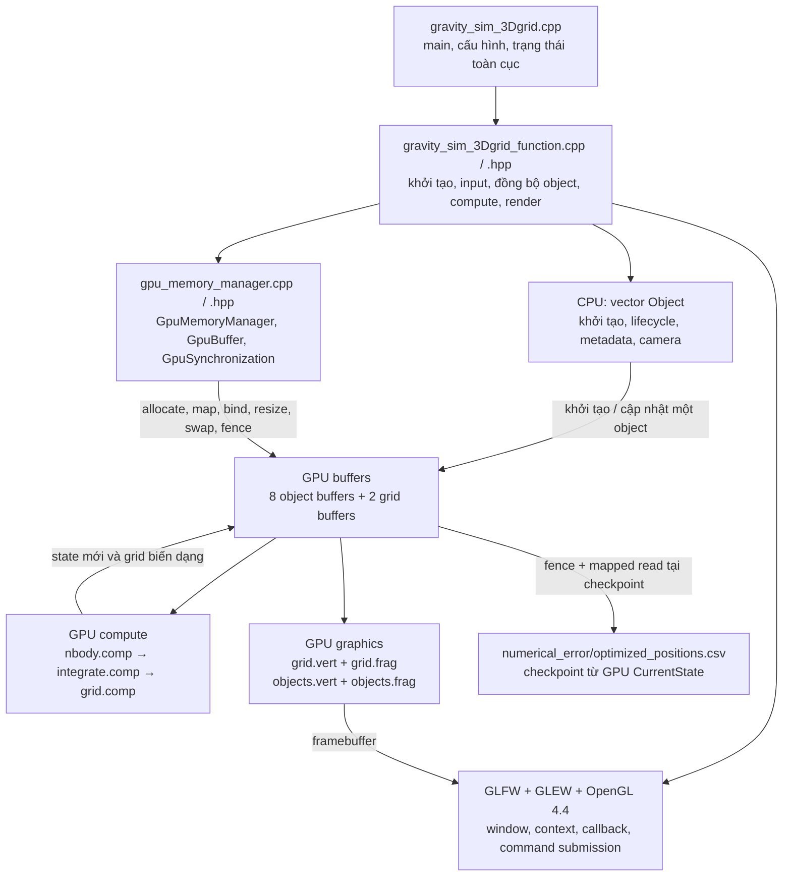
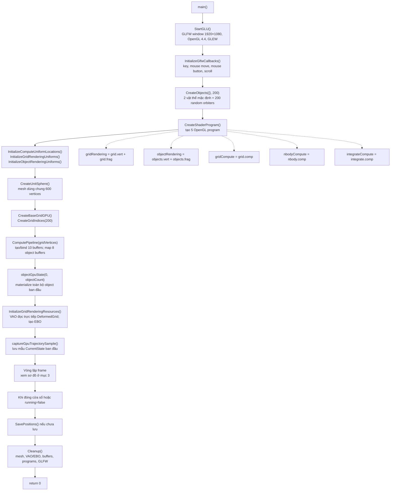
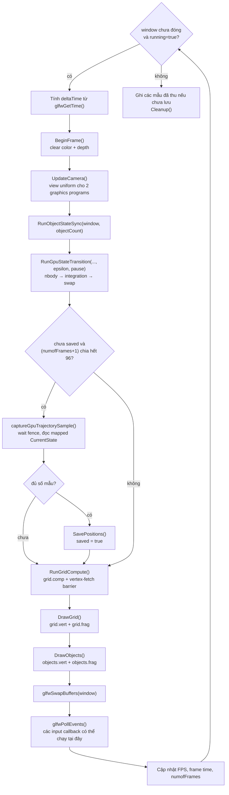
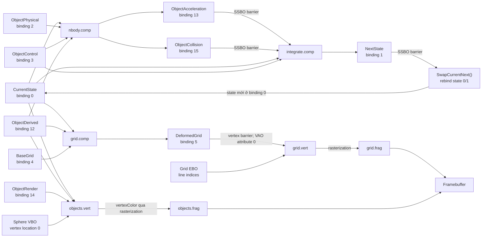
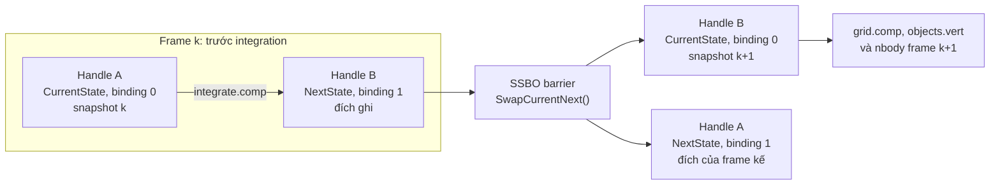
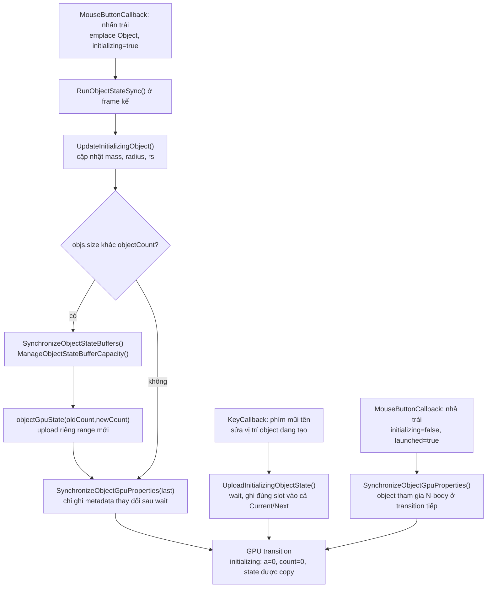
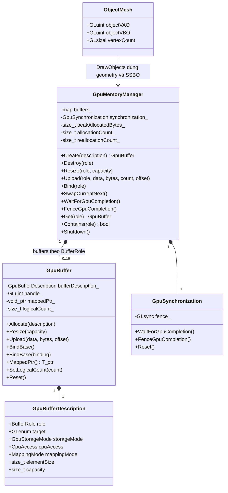
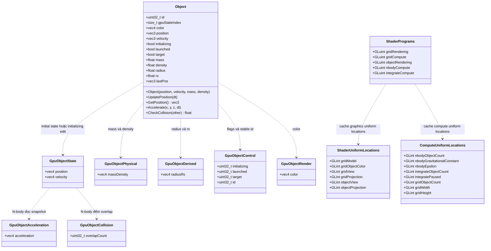
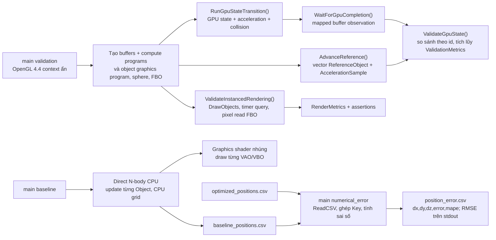

# Sơ đồ hệ thống gravity_sim hiện tại

Tài liệu đối chiếu trực tiếp mã nguồn ngày **28/10/2026**, tại HEAD `1f873a6`. Phần chính mô tả executable `gravity_sim_3Dgrid`; phụ lục liệt kê cả baseline, validation, công cụ sai số và legacy. Các sơ đồ biểu diễn **mã đã triển khai**, các role/shader chưa nối vào runtime được ghi riêng.

Phạm vi kiểm kê: 23 định nghĩa struct/class C++ do dự án khai báo, 4 enum class và 6 tên struct GLSL khác nhau. Không tính kiểu của thư viện GLM, STL, GLFW/OpenGL; khai báo trước `class Object;` không phải một định nghĩa mới.

## 1. Các thành phần của hệ thống



`main()` điều phối. Các hàm trong `gravity_sim_3Dgrid_function.cpp` gửi lệnh OpenGL; `GpuMemoryManager` quản lý tài nguyên và vai trò buffer. GPU giữ position/velocity đang mô phỏng; CPU không chạy vòng Direct N-body cho runtime chính.

| Target/file | Vai trò và đường chạy thực tế |
|---|---|
| `gravity_sim_3Dgrid` | `main` + function module + memory manager; mô phỏng và render trên GPU. |
| `gravity_sim_3Dgrid_baseline` | Executable độc lập, physics CPU và geometry từng object; graphics shader nhúng trong C++. CMake có liệt kê/copy `grid.*`, nhưng baseline không chạy các file shader này. |
| `src/legacy/gravity_sim_3Dgrid_phase2_validation.cpp` | Harness validation đã lưu trữ; không còn là target CMake hoặc được đăng ký với CTest. |
| `src/numerical_error.cpp` | `main()` phân tích CSV độc lập; chưa có target trong CMake hiện tại. |
| `src/legacy/gravity_sim.cpp`, `src/legacy/3D_test.cpp` | Chương trình cũ có `main()` riêng; không thuộc target CMake hiện tại. |

## 2. `main()` khởi tạo và gọi đến đâu?

Nguồn: `src/gravity_sim_3Dgrid.cpp:48`, `src/gravity_sim_3Dgrid_function.cpp:103`.



Các hàm khởi tạo chính:

| Hàm | Hàm con / công việc |
|---|---|
| `StartGLU()` | `glfwInit`, tạo context/window, `glewInit`, kiểm tra OpenGL 4.4, `PrintComputeLimits`, depth test, blending, viewport. |
| `CreateObjects(path, count)` | Nếu có path: đọc CSV `px,py,pz,vx,vy,vz,mass,density`. Nếu path rỗng: tạo 2 object mặc định, gọi `CreateRandomOrbiters(count, ...)`, seed 123. |
| `CreateShaderProgram()` | Gọi `CreateGraphicsProgram()` 2 lần và `CreateComputeProgram()` 3 lần. Các hàm này đọc file bằng `LoadShaderSource()`, compile và link. |
| `InitializeComputeUniformLocations()` | Cache location của 8 compute uniform; ném exception nếu uniform bắt buộc không tìm thấy. |
| `CreateUnitSphere()` | `SphericalToCartesian()` → `CreateMeshBuffers()`; 10 stacks × 10 sectors × 6 vertices, một VAO/VBO dùng chung. |
| `CreateBaseGridGPU()` | `CreateGridVertices(gridSize, gridDivisions)` → đổi mỗi xyz thành `vec4(x,y,z,1)`. Lưới nằm trên mặt phẳng XZ, baseY = -800. |
| `ComputePipeline()` | Kiểm tra có binding 15, tính capacity, tạo 8 object buffers và BaseGrid/DeformedGrid; upload BaseGrid. Hàm này thiết lập bộ nhớ, chưa dispatch shader. |
| `objectGpuState(first, end)` | Ghi range `[first,end)` vào các buffer; set `gpuStateIndex`, khởi tạo cả Current/Next, zero acceleration/collision, cập nhật logical count. |
| `InitializeGridRenderingResources()` | Gắn DeformedGrid làm vertex source location 0 của grid VAO và upload các chỉ số đường lưới vào EBO. |
| `Cleanup()` | Hủy sphere, grid VAO/EBO, `gpuMemoryManager.Shutdown()`, xóa 5 program, xóa objects/counters và `glfwTerminate()`. |

Với cấu hình mặc định: **N = 202**, object capacity **256**, lưới **201 × 201 = 40.401 nodes**, **160.800 indices** tương ứng **80.400 đoạn thẳng**.

## 3. Thứ tự thực thi một frame



- `deltaTime` phục vụ camera và tăng mass của object đang tạo. Nó không được đưa vào shader tích phân.
- `RunObjectStateSync()` gọi lần lượt `UpdateInitializingObject()`, đồng bộ count/capacity khi cần, rồi `SynchronizeObjectGpuProperties()` cho object cuối nếu đang initializing.
- `RunGpuStateTransition()` trả về ngay khi `N == 0`; khi đó không dispatch N-body/integration và không swap. Grid compute vẫn chạy với N bằng 0 để ghi lưới phẳng.
- `pause` vẫn chạy N-body để tính acceleration/collision từ snapshot hiện tại. Integration copy nguyên state sang Next, sau đó vẫn swap.
- CPU gửi lệnh theo đúng thứ tự trên trong cùng OpenGL context. Các nhánh trong sơ đồ dữ liệu ở mục sau biểu diễn quan hệ producer/consumer, không khẳng định các pass được submit song song.

### 3.1. Nhánh xuất quỹ đạo

`main()` đặt `dt = 1/96`, `T = 10`, `numSteps = 960`, `trajectorySampleInterval = 96`, dự kiến 11 mẫu: mẫu đầu + mỗi 96 frame. Mỗi lần lấy mẫu gọi `WaitForGpuCompletion()` rồi đọc `CurrentState.MappedPtr<GpuObjectState>()`. Không đọc toàn bộ vị trí về CPU mỗi frame trong đường render thông thường.

`SavePositions("numerical_error/optimized_positions.csv", positions, dt*96)` ghi `time,step,object_id,x,y,z`. `step` là chỉ số mẫu; `object_id` hiện là chỉ số slot trong mẫu, **không phải** `Object::id`. Điều kiện lấy mẫu đếm frame kể cả khi pause, nên nhãn thời gian CSV là thời gian danh nghĩa theo số mẫu. Sau khi đủ mẫu và lưu, chương trình vẫn tiếp tục chạy.

## 4. Các shader kết nối với nhau qua dữ liệu

Compute shader không gọi shader khác như gọi hàm C++. CPU chọn program bằng `glUseProgram()`, đặt uniforms và gọi `glDispatchCompute()`. Các pass truyền dữ liệu qua SSBO; graphics vertex/fragment kết nối trong một linked graphics program.



Lưới biến dạng là **đầu ra trực quan**. `nbody.comp` không đọc DeformedGrid, MassField hay AccelerationField để tính lực. `objects.vert` cũng không đọc kết quả của `grid.comp`; cả hai sử dụng CurrentState mới sau integration.

## 5. Binding, dữ liệu và quyền truy cập

Nguồn ánh xạ: `BindingFor()` trong `include/gpu_memory_manager.hpp:48`. Tất cả SSBO shader đang dùng có layout `std430`. **Binding index** là điểm gắn SSBO; **uniform location** và **vertex attribute location 0** là các không gian chỉ số khác.

Trong bảng: R/W là đọc/ghi từ phía shader. `CpuAccess` chỉ cấu hình quyền của CPU mapping, không quyết định quyền GPU. Tám object buffers đều dùng `PersistentCoherent` và cùng capacity; hai grid buffers không map.

| Binding | BufferRole | Kiểu phần tử / stride | CpuAccess | Shader đọc | Shader ghi / khởi tạo |
|---:|---|---|---|---|---|
| 0 | `CurrentState` | `GpuObjectState`, 32 B | ReadWrite | nbody, integrate, grid.comp, objects.vert | CPU khởi tạo/chỉnh object đang tạo; nhận handle Next sau swap |
| 1 | `NextState` | `GpuObjectState`, 32 B | ReadWrite | Thành CurrentState sau swap | integrate; CPU khởi tạo/chỉnh object đang tạo |
| 2 | `ObjectPhysical` | `GpuObjectPhysical`, 16 B | Write | nbody | CPU: mass/density |
| 3 | `ObjectControl` | `GpuObjectControl`, 16 B | Write | nbody, integrate | CPU: flags/id |
| 4 | `BaseGrid` | `glm::vec4`, 16 B | None | grid.comp | CPU upload một lần bằng buffer API |
| 5 | `DeformedGrid` | `glm::vec4`, 16 B | None | Vertex fetch qua grid VAO, không qua SSBO trong grid.vert | grid.comp |
| 6 | `MassField` | Chưa định nghĩa phần tử / chưa allocate | — | Chưa dùng | Role dự phòng |
| 7 | `BlurFieldA` | Chưa định nghĩa phần tử / chưa allocate | — | Chưa dùng | Role dự phòng |
| 8 | `BlurFieldB` | Chưa định nghĩa phần tử / chưa allocate | — | Chưa dùng | Role dự phòng |
| 9 | `AccelerationField` | Chưa định nghĩa phần tử / chưa allocate | — | Chưa dùng | Role dự phòng |
| 10 | `LODMetadata` | Chưa định nghĩa phần tử / chưa allocate | — | Chưa dùng | Role dự phòng |
| 11 | `Metrics` | Chưa định nghĩa phần tử / chưa allocate | — | Chưa dùng | Role dự phòng |
| 12 | `ObjectDerived` | `GpuObjectDerived`, 16 B | Write | nbody, grid.comp, objects.vert | CPU: radius/rs |
| 13 | `ObjectAcceleration` | `GpuObjectAcceleration`, 16 B | Read | integrate; CPU tại validation | nbody; zero ban đầu qua buffer API |
| 14 | `ObjectRender` | `GpuObjectRender`, 16 B | Write | objects.vert | CPU: color |
| 15 | `ObjectCollision` | `GpuObjectCollision`, 4 B | ReadWrite | integrate; CPU tại validation | nbody; CPU zero ban đầu |

### 5.1. Ai thực hiện bind?

1. `GpuMemoryManager::Create()` tạo `GpuBuffer` và gọi `BindBase()` ngay. `GpuBuffer::BindBase()` dùng `glBindBufferBase(target, BindingFor(role), handle)`; runtime không dùng `glBindBufferRange()`.
2. Các hàm dispatch dùng binding đã thiết lập, không bind lại tất cả buffers mỗi frame.
3. `SwapCurrentNext()` đổi buffer vật lý đang sở hữu hai role và bind lại 0/1.
4. `GpuMemoryManager::Resize()` bind lại handle thay thế sau khi resize.
5. `DrawObjects()` bind lại CurrentState, ObjectDerived và ObjectRender trước draw.
6. `InitializeGridRenderingResources()` bind DeformedGrid bằng `GL_ARRAY_BUFFER` để lưu vertex source trong VAO: location 0, xyz là 3 float, stride 16 B, offset 0. Cùng handle vừa là SSBO output của compute vừa là vertex source; không copy grid từ GPU qua CPU hay sang VBO trung gian.

Tổng tám object buffers là **148 B/capacity slot**, gồm hai state buffers. BaseGrid và DeformedGrid thêm tổng **32 B/grid node**, chưa gồm EBO/sphere/driver overhead. `DeformedGrid` hiện chưa được set logical count, nên `GpuMemoryManager::LogicalBytes()` chưa cộng phần grid này dù buffer đã cấp phát và shader đang sử dụng.

## 6. Dispatch, uniforms và thuật toán từng shader

| Pass / hàm CPU | Local size GLSL | Lệnh submit | Phần dư / trường hợp rỗng |
|---|---|---|---|
| N-body / `RunNBodyCompute()` | `(64,1,1)` | `glDispatchCompute((N+63)/64,1,1)` | Bỏ dispatch khi N=0; shader return nếu index≥N. |
| Integration / `RunIntegration()` | `(64,1,1)` | `glDispatchCompute((N+63)/64,1,1)` | Bỏ dispatch khi N=0; shader return nếu index≥N. |
| Grid / `RunGridCompute()` | `(16,16,1)` | `glDispatchCompute((W+15)/16,(H+15)/16,1)`, W=H=`gridDivisions+1` | Guard x≥W hoặc z≥H; N=0 vẫn dispatch. |
| Grid render / `DrawGrid()` | Không áp dụng | `glDrawElements(GL_LINES,gridIndexCount,GL_UNSIGNED_INT,0)` | Index buffer là topology cố định. |
| Object render / `DrawObjects()` | Không áp dụng | `glDrawArraysInstanced(GL_TRIANGLES,0,600,N)` | N=0 không draw; kiểm tra count và dense slot trước draw. |

Mặc định N=202: mỗi object compute pass có 4 groups, 256 invocations; grid có 13×13 groups, 43.264 invocations cho 40.401 node hợp lệ. `glDispatchCompute()` nhận **số workgroups**, không phải số object hoặc số invocation.

| Program | Uniform / kiểu | Giá trị từ CPU |
|---|---|---|
| `nbodyCompute` | `u_objectCount: uint` | `objectCount` |
| `nbodyCompute` | `u_gravitationalConstant: double` | `kGravitationalConstant = 6.6743e-11`, `glUniform1d` |
| `nbodyCompute` | `u_epsilon: float` | `epsilon = 10.0f` từ main |
| `integrateCompute` | `u_objectCount: uint`, `u_paused: uint` | N, `pause` đổi thành 0/1 |
| `gridCompute` | `u_objectCount: uint`, `u_gridWidth: uint`, `u_gridHeight: uint` | N, `gridDivisions+1`, `gridDivisions+1` |
| `gridRendering` | `model`, `view`, `projection: mat4` | model identity; view từ camera; projection khởi tạo |
| `gridRendering` | `objectColor: vec4` | `(1,1,1,0.25)` trong DrawGrid |
| `objectRendering` | `view`, `projection: mat4` | view/projection dùng cùng cấu hình camera với grid |

Projection: FOV 45°, aspect 1920/1080, near 0.1, far 750000. `UpdateCamera()` cập nhật view bằng `glm::lookAt()` mỗi frame. Grid shaders dùng GLSL 430; các shader object và compute hiện hoạt dùng GLSL 440, chạy trong context OpenGL 4.4.

### 6.1. `nbody.comp`: snapshot → acceleration và overlap count

Một invocation xử lý một target `i`, đọc cùng snapshot CurrentState và duyệt toàn bộ source `j`: độ phức tạp O(N²). Initializing target nhận acceleration và collision count bằng 0; initializing source bị bỏ qua. Bỏ qua self-interaction và khoảng cách ≤0.

```text
displacement = position[j] - position[i]
distance = length(displacement)
distanceMeters = distance * 1000
force = G * mass[i] * mass[j] / (distanceMeters² + epsilon²)
pairAcceleration = normalize(displacement) * float(force / mass[i])
acceleration[i] = tổng pairAcceleration
overlapCount[i] = số source có radius[j] + radius[i] > distance
```

G và phép tính lực dùng double; vị trí, vector gia tốc, phép cộng tổng và output dùng float. `radiusRs.x` dùng cho overlap. Vì nhánh distance≤0 đi trước collision check, hai vật thể trùng tọa độ bị bỏ qua cả gia tốc lẫn overlap. Mỗi invocation chỉ ghi acceleration/collision của chính target; không có scatter update sang source.

### 6.2. `integrate.comp`: snapshot và acceleration → NextState

```text
nếu !initializing && !paused:
    vNext = (vCurrent + acceleration / 96.0) * (-0.2)^overlapCount
    pNext = pCurrent + vNext / 94.0
    giữ nguyên position.w và velocity.w
ngược lại:
    NextState[i] = CurrentState[i]
```

Shader thực hiện nhân `-0.2` trong vòng lặp `overlapCount` lần. Đây là phản ứng va chạm đơn giản dựa trên số overlap của snapshot, không có giải quyết tiếp xúc hay cập nhật cặp đối xứng. Hệ số `/96` và `/94` được hard-code trong shader; **không có uniform dt**, không thể suy ra bước GPU bằng `dt` của CPU. Pass ghi một slot NextState cho mỗi invocation hợp lệ; bình thường O(N), thêm vòng lặp theo overlap count.

### 6.3. `grid.comp`: state mới và rs → lưới trực quan

Một invocation xử lý node `(x,z)`, `gridIndex = z*W+x`. Đọc BaseGrid để tính từ lưới gốc mỗi frame, không cộng dồn biến dạng frame trước:

```text
dy = 0
với mỗi object i:
    rs = radiusRs[i].y
    distanceMeters = max(length(position[i] - basePosition)*1000, rs*1.0001)
    nếu rs > 0: dy -= 2.0e11 * rs / distanceMeters
DeformedGrid[index] = vec4(base.x, base.y + dy, base.z, 1)
```

Độ phức tạp O(W·H·N). Shader dùng `radiusRs.y` (Schwarzschild radius), không dùng visual radius `.x`. Không đọc ObjectControl, vì vậy object đang initializing vẫn tạo biến dạng grid.

### 6.4. Graphics shaders

- `grid.vert`: input `aPos` ở vertex location 0, `gl_Position = projection*view*model*vec4(aPos,1)`; `grid.frag` xuất uniform `objectColor` thành `FragColor`.
- `objects.vert`: input unit-sphere `localPosition` ở location 0, dùng `uint(gl_InstanceID)` chọn slot; `worldPosition = CurrentState[i].position.xyz + localPosition*radiusRs[i].x`. Xuất `projection*view*vec4(worldPosition,1)` và `vertexColor`.
- `objects.frag`: nhận `vertexColor` từ vertex stage qua rasterization/interpolation, xuất `fragmentColor`.
- `DrawObjects()` render toàn bộ packed range, kể cả initializing object; không đọc ObjectControl. Một draw submission cho N object, nhưng CPU vẫn duyệt O(N) để kiểm tra `gpuStateIndex == index`.

## 7. Barrier, fence và thứ tự nhìn thấy dữ liệu

Nguồn: `src/gravity_sim_3Dgrid_function.cpp:741`, `src/gpu_memory_manager.cpp:202`.

```mermaid
sequenceDiagram
    participant CPU as CPU main / callbacks
    participant MM as GpuMemoryManager
    participant BUF as GPU buffers
    participant GL as OpenGL command stream
    participant NB as nbody.comp
    participant IT as integrate.comp
    participant GC as grid.comp
    participant GR as Graphics shaders

    opt Có thêm object hoặc sửa dữ liệu mapped đang được GPU dùng
        CPU->>MM: WaitForGpuCompletion()
        MM->>GL: Client mapped barrier + glFenceSync
        MM->>GL: glClientWaitSync đến khi signaled
        CPU->>BUF: Ghi mapped state / metadata
        Note over CPU,MM: Nếu cần resize, manager cấp/copy/bind buffer thay thế.
    end
    CPU->>GL: B0: GL_CLIENT_MAPPED_BUFFER_BARRIER_BIT
    CPU->>NB: Dispatch ceil(N/64),1,1
    NB->>BUF: Ghi Acceleration b13 và Collision b15
    CPU->>GL: B1: GL_SHADER_STORAGE_BARRIER_BIT
    CPU->>IT: Dispatch ceil(N/64),1,1
    IT->>BUF: Ghi NextState b1
    CPU->>GL: B2: GL_SHADER_STORAGE_BARRIER_BIT
    CPU->>MM: SwapCurrentNext() và rebind b0/b1
    opt Đến checkpoint quỹ đạo
        CPU->>MM: WaitForGpuCompletion()
        MM->>GL: Client mapped barrier + fence + client wait
        CPU->>BUF: Đọc mapped CurrentState mới
    end
    CPU->>GC: Dispatch ceil(W/16),ceil(H/16),1
    GC->>BUF: Ghi DeformedGrid b5
    CPU->>GL: B3: GL_VERTEX_ATTRIB_ARRAY_BARRIER_BIT
    CPU->>GR: DrawGrid: vertex fetch DeformedGrid
    CPU->>GR: DrawObjects: đọc SSBO b0/b12/b14
    Note over CPU,GR: Thứ tự trên áp dụng khi N > 0; barrier GPU không phải CPU wait.
```

| Điểm | Lệnh trong mã | Producer → consumer / ý nghĩa |
|---|---|---|
| B0 | `RunGpuStateTransition(): glMemoryBarrier(GL_CLIENT_MAPPED_BUFFER_BARRIER_BIT)` | Điểm barrier cho đường mapped CPU/GPU trước compute. Mapping hiện tại là coherent; coherent không thay thế chờ GPU hoàn tất trước khi CPU sửa vùng đang dùng. |
| B1 | Cuối `RunNBodyCompute(): GL_SHADER_STORAGE_BARRIER_BIT` | Ghi b13/b15 của N-body → đọc SSBO trong integration. |
| B2 | Cuối `RunIntegration(): GL_SHADER_STORAGE_BARRIER_BIT` | Ghi NextState → đọc SSBO sau khi buffer đó trở thành CurrentState trong grid/object shader và pass kế tiếp. |
| B3 | Cuối `RunGridCompute(): GL_VERTEX_ATTRIB_ARRAY_BARRIER_BIT` | Ghi SSBO DeformedGrid → fetch vertex attribute của grid VAO. |
| Checkpoint / CPU mutation | `WaitForGpuCompletion()` | Nếu chưa có fence: tạo fence sau client mapped barrier; gọi `glClientWaitSync`, lặp nếu timeout, xóa fence khi hoàn tất. Cho phép CPU đọc/sửa mapped memory sau lệnh GPU trước fence. |

Các compute shader hiện hoạt không có `barrier()`, `memoryBarrier()`, shared memory hay atomic. Input là snapshot readonly; mỗi invocation có output slot riêng. Đồng bộ producer/consumer giữa các dispatch nằm ở host barriers. `glMemoryBarrier()` xử lý visibility/order theo consumer; nó không bảo đảm CPU có thể đọc kết quả ngay như một fence wait.

Fence chỉ bao phủ lệnh đã submit trước vị trí đặt fence. Normal render path không chờ fence mỗi frame; các checkpoint, materialization, sửa metadata thật sự, resize và shutdown có thể chờ. `GpuMemoryManager::Upload()` tự nó không chờ GPU; caller phải bảo đảm đồng bộ.

## 8. Ping-pong CurrentState / NextState



`SwapCurrentNext()` dùng `std::swap` trên hai `GpuBuffer`, đặt lại role nội bộ rồi gọi `BindBase()` cho 0/1. Handle, mapping, description và logical count đi cùng buffer vật lý; không copy toàn bộ state và không fence trong swap. Vì vậy không được cache handle hay mapped pointer rồi mặc định nó luôn đại diện CurrentState qua các lần swap. Trajectory capture lấy lại role CurrentState mỗi lần.

`Object::id` là định danh logic ổn định, 0 là invalid. `gpuStateIndex` là slot GPU; runtime hiện duy trì `objs[i].gpuStateIndex == i`. Không có workflow xóa/reorder/compaction object; append là đường lifecycle đang dùng.

## 9. Lifecycle object và đồng bộ CPU → GPU



`CalculateObjectStateBufferCapacity()` bắt đầu từ 256 và nhân đôi khi cần. `ManageObjectStateBufferCapacity()` resize đồng loạt 8 object buffers; có nhánh giảm một nửa nếu count≤capacity/4 và capacity>256, dù UI hiện chưa có đường xóa object.

`GpuBuffer::Resize()` cấp buffer immutable thay thế bằng `glBufferStorage`, copy `min(oldLogicalCount,newCapacity)*elementSize` bằng `glCopyBufferSubData`, chuyển ownership rồi bind lại role. Giữ dữ liệu GPU cũ, không dựng lại vị trí/velocity đang chạy từ CPU Object.

`SynchronizeObjectGpuProperties()` so sánh physical/derived/render bằng absolute+relative tolerance và control bằng so sánh nguyên; chỉ khi có thay đổi mới wait rồi ghi. Có chi tiết API cần biết khi đọc thiết kế hiện tại: các buffer metadata được map với `CpuAccess::Write`, nhưng hàm này vẫn đọc mapped pointer để so sánh dữ liệu cũ; mô tả quyền map không được hiểu là đã có read mapping hợp lệ cho các thao tác đó. Tài liệu này ghi nhận hành vi mã hiện tại, không sửa implementation.

## 10. Toàn bộ class/struct của runtime chính

Runtime có **4 class + 12 struct = 16 định nghĩa**. Hai sơ đồ dưới đây đi kèm bảng thành viên đầy đủ; dấu quan hệ thể hiện sở hữu/phụ thuộc, không có kế thừa trong thiết kế hiện tại.

### 10.1. Lớp quản lý GPU và tài nguyên render



`ObjectMesh` là struct global nội bộ module function, không phải member của manager. Global `objectMesh` giữ một sphere VAO/VBO và `vertexCount=600` sau khởi tạo. Geometry không nằm trong map SSBO của manager.

| Kiểu / nguồn | Toàn bộ thành viên dữ liệu | API / trách nhiệm |
|---|---|---|
| `GpuBufferDescription`, `include/gpu_memory_manager.hpp:88` | `BufferRole role`; `GLenum target=GL_SHADER_STORAGE_BUFFER`; `GpuStorageMode storageMode=GpuResident`; `CpuAccess cpuAccess=None`; `MappingMode mappingMode=None`; `size_t elementSize=0, capacity=0` | Mô tả role, storage/mapping policy, stride và capacity; không chứa handle hay logical count. |
| `GpuBuffer`, cùng header `:99` | Private `GpuBufferDescription bufferDescription_`; `GLuint handle_=0`; `void* mappedPtr_=nullptr`; `size_t logicalCount_=0` | RAII, move-only: default/description constructor, destructor, move constructor/operator; copy constructor/operator bị xóa. `Allocate`, `Resize`, `Upload`, `BindBase()`/`BindBase(binding)`, `Reset`, `MappedPtr<T>()` const/non-const, `Handle`, `Desc`, `LogicalCount`, `Capacity`, `LogicalBytes`, `AllocatedBytes`, `IsMapped`, `SetLogicalCount`. Private `SetRole`, `AllocateStorage`; friend `GpuMemoryManager`. |
| `GpuSynchronization`, cùng header `:143` | Private `GLsync fence_=nullptr` | Destructor gọi `Reset`; API `WaitForGpuCompletion`, `FenceGpuCompletion`, `Reset`. Chứa một fence, không phải hệ thống fence riêng cho từng buffer. |
| `GpuMemoryManager`, cùng header `:155` | Private `std::map<BufferRole,GpuBuffer> buffers_`; `GpuSynchronization synchronization_`; `size_t peakAllocatedBytes_=0, allocationCount_=0, reallocationCount_=0` | `Create`, `Destroy`, `Resize`, `Upload`, `Bind`, `SwapCurrentNext`, `WaitForGpuCompletion`, `FenceGpuCompletion`, `Get` const/non-const, `Contains`, `Shutdown`; metrics `LogicalBytes`, `AllocatedBytes`, `PeakAllocatedBytes`, `AllocationCount`, `ReallocationCount`, `MappedBufferCount`, `PersistentMappedBytes`; private `UpdatePeakAllocation`. |
| `ObjectMesh`, `src/gravity_sim_3Dgrid_function.cpp:49` | `GLuint objectVAO=0, objectVBO=0`; `GLsizei vertexCount=0` | Struct giữ handles/count; các hàm free `CreateUnitSphere`, `CreateMeshBuffers`, `DestroyObjectRenderingResources` quản lý vòng đời. |

`AllocateStorage()` luôn dùng `GL_DYNAMIC_STORAGE_BIT`; thêm READ/WRITE theo CpuAccess, PERSISTENT theo MappingMode và COHERENT nếu `PersistentCoherent`. `Upload()` dùng `memcpy` nếu có writable mapping; nếu không dùng `glBufferSubData`. `MappedPtr<T>()` chỉ cast pointer, không kiểm tra quyền CPU access hay tự chờ fence. Enum có `Persistent` không coherent, nhưng runtime hiện chỉ tạo mapping coherent; implementation chưa có nhánh flush tường minh cho non-coherent mapped writes.

### 10.2. Object CPU, các record GPU và cấu hình program



| Kiểu / nguồn trong `include/gravity_sim_3Dgrid_function.hpp` | Toàn bộ field và ý nghĩa |
|---|---|
| `ShaderPrograms:34` | 5 `GLuint`: `gridRendering`, `gridCompute`, `objectRendering`, `nbodyCompute`, `integrateCompute`; mặc định 0; mỗi giá trị là program handle. |
| `ShaderUniformLocations:43` | 6 `GLint`: `gridModel`, `gridObjectColor`, `gridView`, `gridProjection`, `objectView`, `objectProjection`; mặc định -1. |
| `ComputeUniformLocations:53` | 8 `GLint`: `nbodyObjectCount`, `nbodyGravitationalConstant`, `nbodyEpsilon`, `integrateObjectCount`, `integratePaused`, `gridObjectCount`, `gridWidth`, `gridHeight`; mặc định -1. |
| `Object:118` | `uint32_t id=0`; `size_t gpuStateIndex=max`; `glm::vec4 color=(1,0,0,1)`; `glm::vec3 position=(400,300,0), velocity=(0,0,0)`; `bool initializing=false, launched=false, target=false`; `float mass,density,radius,rs`; `glm::vec3 lastPos=position`. |
| `GpuObjectState:191` | `glm::vec4 position, velocity`; xyz là state, `.w` ban đầu 0 và được integration bảo toàn; 32 B. Cả Current và Next dùng struct này. |
| `GpuObjectPhysical:197` | `glm::vec4 massDensity`: x=mass, y=density, zw=0; 16 B. N-body hiện chỉ đọc mass. |
| `GpuObjectDerived:202` | `glm::vec4 radiusRs`: x=visual/collision radius, y=Schwarzschild radius, zw=0; 16 B. |
| `GpuObjectControl:207` | 4 `uint32_t`: `initializing, launched, target, id`; 16 B; id offset 12 B. Flags dùng uint thay cho bool để khớp GLSL layout. |
| `GpuObjectAcceleration:217` | `glm::vec4 acceleration`; xyz là tổng gia tốc, w=0; 16 B. |
| `GpuObjectCollision:222` | `uint32_t overlapCount`; 4 B, mảng scalar struct trong std430 có stride 4 B. |
| `GpuObjectRender:227` | `glm::vec4 color`; RGBA, 16 B. |

`Object` constructor gọi `AllocateObjectId()`, gán position/velocity/mass/density, tính `radius = cbrt((3*mass/density)/(4*pi))/100000` và `rs = 2*G*mass/c²`. `AllocateObjectId()` cấp ID đơn điệu từ 1 trong một lần chạy.

Các method `UpdatePosition(dt)`, `Accelerate(x,y,z,dt)`, `CheckCollision(other)` vẫn tồn tại trong class, nhưng main runtime GPU không gọi chúng để tiến hóa physics. `GetPosition()` dùng khi materialize/chỉnh object đang tạo. CPU Object không được refresh position/velocity từ GPU mỗi frame; đọc hai field đó sau khi mô phỏng chạy không phải là lấy state GPU hiện tại. `lastPos` còn là field phụ, chưa dùng trong đường main hiện tại. Trong shader, `launched`, `target`, `id` có trong layout, nhưng điều kiện hoạt động hiện chỉ đọc `initializing`.

Header có `static_assert` kiểm tra kích thước của 7 record GPU và offset `GpuObjectControl::id`; không upload nguyên class Object vào SSBO.

### 10.3. Toàn bộ enum class

Tất cả nằm trong `include/gpu_memory_manager.hpp`, underlying type `std::uint8_t`.

| Enum | Các giá trị | Cách dùng hiện tại |
|---|---|---|
| `BufferRole:8` | `CurrentState, NextState, ObjectPhysical, ObjectControl, BaseGrid, DeformedGrid, MassField, BlurFieldA, BlurFieldB, AccelerationField, LODMetadata, Metrics, ObjectDerived, ObjectAcceleration, ObjectRender, ObjectCollision` | Khóa map manager và ánh xạ binding 0…15; 6 role giữa chưa được allocate. |
| `GpuStorageMode:28` | `GpuResident` | Mode duy nhất được hỗ trợ. Tên policy không phải phép đo vị trí VRAM vật lý của driver. |
| `CpuAccess:33` | `None, Read, Write, ReadWrite` | Quyết định map flags READ/WRITE. |
| `MappingMode:41` | `None, Persistent, PersistentCoherent` | Runtime chọn None cho grid và PersistentCoherent cho object buffers. |

## 11. Toàn bộ struct và interface block GLSL

Không có class GLSL. Sáu tên struct dưới đây được khai báo lặp ở các shader độc lập để khớp ABI với record C++.

| Struct GLSL | Field đầy đủ | File khai báo | Tương ứng C++ |
|---|---|---|---|
| `ObjectState` | `vec4 position; vec4 velocity;` | `nbody.comp:5`, `integrate.comp:5`, `grid.comp:5`, `objects.vert:5` | `GpuObjectState` |
| `ObjectPhysical` | `vec4 massDensity;` | `nbody.comp:11` | `GpuObjectPhysical` |
| `ObjectControl` | `uint initializing; uint launched; uint target; uint id;` | `nbody.comp:16`, `integrate.comp:11` | `GpuObjectControl` |
| `ObjectDerived` | `vec4 radiusRs;` | `nbody.comp:24` | `GpuObjectDerived` |
| `ObjectAcceleration` | `vec4 acceleration;` | `nbody.comp:29`, `integrate.comp:19` | `GpuObjectAcceleration` |
| `ObjectCollision` | `uint overlapCount;` | `nbody.comp:34`, `integrate.comp:24` | `GpuObjectCollision` |

Interface block không phải user-defined struct. Bảng sau liệt kê đầy đủ các block đang hoạt động, kể cả các block trùng tên giữa program:

| Shader | Block → array member (binding, access) |
|---|---|
| `nbody.comp` | `CurrentStateBuffer → ObjectState objects[]` (0,R); `ObjectPhysicalBuffer → ObjectPhysical physical[]` (2,R); `ObjectControlBuffer → ObjectControl controls[]` (3,R); `ObjectDerivedBuffer → ObjectDerived derived[]` (12,R); `ObjectAccelerationBuffer → ObjectAcceleration accelerations[]` (13,W); `ObjectCollisionBuffer → ObjectCollision collisions[]` (15,W). |
| `integrate.comp` | `CurrentStateBuffer → ObjectState currentState[]` (0,R); `NextStateBuffer → ObjectState nextState[]` (1,W); `ObjectControlBuffer → ObjectControl controls[]` (3,R); `ObjectAccelerationBuffer → ObjectAcceleration accelerations[]` (13,R); `ObjectCollisionBuffer → ObjectCollision collisions[]` (15,R). |
| `grid.comp` | `CurrentStateBuffer → ObjectState objects[]` (0,R); `ObjectDerivedBuffer → vec4 radiusRs[]` (12,R); `BaseGridBuffer → vec4 basePositions[]` (4,R); `DeformedGridBuffer → vec4 deformedPositions[]` (5,W). |
| `objects.vert` | `CurrentStateBuffer → ObjectState currentState[]` (0,R); `ObjectDerivedBuffer → vec4 radiusRs[]` (12,R); `ObjectRenderBuffer → vec4 objectColors[]` (14,R). |
| `grid.vert`, `grid.frag`, `objects.frag` | Không có SSBO block. |

`vec4 radiusRs[]` ở grid/object shader tương thích với mảng `GpuObjectDerived` vì struct C++ chỉ chứa một vec4. `vec4 objectColors[]` tương thích với `GpuObjectRender` tương tự. Không có GLSL struct tên `ObjectRender`.

## 12. Struct/class ở validation, baseline và công cụ phụ

Đây là **7 định nghĩa còn lại** ngoài 16 định nghĩa runtime: 4 struct validation, 1 class Object baseline, 1 struct Position và 1 class Object legacy. Hai class Object cùng tên nhưng ở translation unit/executable độc lập, không phải subclass của Object runtime.

| Kiểu / nguồn | Toàn bộ field | Method / mục đích |
|---|---|---|
| `ReferenceObject`, `src/legacy/gravity_sim_3Dgrid_phase2_validation.cpp:40` | `uint32_t id`; `glm::vec3 position,velocity`; `float mass,radius`; `bool initializing,launched` | Snapshot CPU oracle; ghép kết quả theo stable id. Không chứa GPU handle. |
| `AccelerationSample`, cùng file `:51` | `uint32_t id`; `glm::vec3 acceleration`; `size_t collisionCount` | Kết quả gia tốc/overlap CPU oracle theo object. |
| `ValidationMetrics`, cùng file `:58` | `size_t checkpoints=0,maxCollisionCountError=0`; `float maxAccelerationError=0,maxRelativeAccelerationError=0,maxPositionError=0,maxVelocityError=0` | Tổng hợp sai số tối đa giữa GPU và oracle. |
| `RenderMetrics`, cùng file `:113` | `std::chrono::nanoseconds cpuSubmitTime{}`; `uint64_t gpuRenderTimeNanoseconds=0`; `size_t drawCalls=0` | Thu thời gian CPU submit/GPU query và số lần gọi helper render. Counter `drawCalls` tăng trong helper kiểm tra; không dùng nó như bộ đếm draw driver tổng quát. |
| `Object` baseline, `src/gravity_sim_3Dgrid_baseline.cpp:92` | `GLuint VAO,VBO`; `glm::vec3 position=(400,300,0),velocity=(0,0,0)`; `size_t vertexCount`; `glm::vec4 color=(1,0,0,1)`; `bool Initalizing=false,Launched=false,target=false`; `float mass,density,radius`; `glm::vec3 LastPos=position` | Constructor tạo mesh riêng; `Draw()`, `UpdatePos(double dt)`, `UpdateVertices()`, `GetPos() const`, `accelerate(x,y,z,double dt)`, `CheckCollision(const Object&)`. `vertexCount` là số float; draw dùng `/3`. Giữ nguyên spelling `Initalizing` của mã. |
| `Position`, `src/numerical_error.cpp:12` | `double x,y,z` | Không method; tọa độ đọc từ CSV. `using Key = tuple<double,int,int>` là alias khóa `(time,step,objectIndex)`, không phải struct mới. |
| `Object` legacy, `src/legacy/gravity_sim.cpp:73` | Các field giống Object baseline ở trên, cộng `bool glow` | Constructor nhận thêm color và Glow; `Draw()`, `UpdatePos()` không dt, `UpdateVertices()`, `GetPos() const`, `accelerate(x,y,z)` không dt, `CheckCollision(const Object&)`. Dùng `/94`, `/96`, bán kính chia `sizeRatio`. |

`src/legacy/3D_test.cpp` không khai báo struct/class riêng.

### 12.1. Các `main()` khác



Validation kiểm tra state transition/ping-pong, pause/resume, initializing/launch, zero objects, overlap, append/resize, layout/binding và rendering instanced từ GPU state. Tài liệu này chỉ kiểm kê đường kiểm tra trong source, không ghi nhận một lần chạy test GPU mới.

Baseline cập nhật state CPU trong vòng lặp object; đây là executable độc lập, không là CPU mirror của runtime GPU. Công cụ `numerical_error.cpp` và đường xuất baseline hiện còn dùng đường dẫn tuyệt đối `E:/UIT/KLTN/ver3/gravity_sim/...`; xuất optimized của main chính dùng đường dẫn tương đối. Muốn so sánh quỹ đạo cần khớp dữ liệu đầu vào, bước tích phân, lịch lấy mẫu và khóa object; việc có sẵn hai CSV không tự chứng minh hai thuật toán tương đương.

## 13. Phần đã khai báo nhưng chưa nối vào runtime

`shaders/spatial_partition.comp` là bản nháp, không được `CreateShaderProgram()` load, không có dispatch từ main và không được copy trong danh sách shader của target chính.

| Thành phần nháp | Nội dung hiện có |
|---|---|
| Local size | `(16,16,1)` nhưng chỉ dùng `gl_GlobalInvocationID.x` làm object index. |
| SSBO block | `CurrentState { ObjectState objects[]; }` binding 0, readonly; `ObjectCellID { uint cellIDs[]; }` binding 6, writeonly. |
| Uniform khai báo | `vec3 u_worldMin`; `float u_cell_size`; `uint u_gridX,u_gridY`. |
| Khai báo còn thiếu | Có dùng `ObjectState` và `u_objectCount` nhưng chưa định nghĩa/khai báo trong file. |
| Cell ID | Mới ghi `uint(cellcoord.x)`; `u_gridX/u_gridY` chưa dùng để tuyến tính hóa tọa độ 3D. |
| Liên quan C++ | `CreateObjectCellID()` ở cuối function.cpp và lời gọi trong main đều bị comment. Globals `CEll_SIZE,worldMin,worldMax,objectCellID` còn dấu vết cho hướng mass aggregation. |

Binding 6 của bản nháp là `ObjectCellID`, trong khi manager dành binding 6 cho role `MassField`; hai tên này chưa được thống nhất thành pipeline đang hoạt động. Mass accumulation, Gaussian blur, acceleration field, LOD và GPU metrics buffer chưa có chuỗi dispatch triển khai. Không vẽ các bước đó như một phần solver hiện tại.

## 14. Bản đồ mã nguồn để tra cứu

Các liên kết dưới đây mở mã nguồn trong workspace hiện tại. Số dòng là vị trí đối chiếu tại snapshot đầu tài liệu.

| Nội dung | Vị trí |
|---|---|
| Targets, library dependencies, shader copy, CTest | [CMakeLists.txt](D:/projects/gravity_sim/CMakeLists.txt) |
| Main chính và cấu hình mặc định | [gravity_sim_3Dgrid.cpp:48](D:/projects/gravity_sim/src/gravity_sim_3Dgrid.cpp:48) |
| Shader/program và uniform init | [gravity_sim_3Dgrid_function.cpp:103](D:/projects/gravity_sim/src/gravity_sim_3Dgrid_function.cpp:103) |
| Khởi tạo OpenGL | [gravity_sim_3Dgrid_function.cpp:223](D:/projects/gravity_sim/src/gravity_sim_3Dgrid_function.cpp:223) |
| Capacity / materialization / property sync | [gravity_sim_3Dgrid_function.cpp:446](D:/projects/gravity_sim/src/gravity_sim_3Dgrid_function.cpp:446) |
| VAO grid / buffer pipeline | [gravity_sim_3Dgrid_function.cpp:655](D:/projects/gravity_sim/src/gravity_sim_3Dgrid_function.cpp:655) |
| Dispatch và GPU barriers | [gravity_sim_3Dgrid_function.cpp:741](D:/projects/gravity_sim/src/gravity_sim_3Dgrid_function.cpp:741) |
| Input/camera/object đang tạo | [gravity_sim_3Dgrid_function.cpp:880](D:/projects/gravity_sim/src/gravity_sim_3Dgrid_function.cpp:880) |
| Draw grid và instanced objects | [gravity_sim_3Dgrid_function.cpp:1071](D:/projects/gravity_sim/src/gravity_sim_3Dgrid_function.cpp:1071) |
| Tạo object ban đầu | [gravity_sim_3Dgrid_function.cpp:1188](D:/projects/gravity_sim/src/gravity_sim_3Dgrid_function.cpp:1188) |
| Runtime Object, GPU records và program/location structs | [gravity_sim_3Dgrid_function.hpp:34](D:/projects/gravity_sim/include/gravity_sim_3Dgrid_function.hpp:34) |
| Roles, binding map và memory class declarations | [gpu_memory_manager.hpp:8](D:/projects/gravity_sim/include/gpu_memory_manager.hpp:8) |
| Allocation/map/resize/upload | [gpu_memory_manager.cpp:37](D:/projects/gravity_sim/src/gpu_memory_manager.cpp:37) |
| Fence/wait | [gpu_memory_manager.cpp:202](D:/projects/gravity_sim/src/gpu_memory_manager.cpp:202) |
| Manager và ping-pong | [gpu_memory_manager.cpp:246](D:/projects/gravity_sim/src/gpu_memory_manager.cpp:246) |
| Solver | [nbody.comp](D:/projects/gravity_sim/shaders/nbody.comp), [integrate.comp](D:/projects/gravity_sim/shaders/integrate.comp) |
| Grid compute/render | [grid.comp](D:/projects/gravity_sim/shaders/grid.comp), [grid.vert](D:/projects/gravity_sim/shaders/grid.vert), [grid.frag](D:/projects/gravity_sim/shaders/grid.frag) |
| Instanced object render | [objects.vert](D:/projects/gravity_sim/shaders/objects.vert), [objects.frag](D:/projects/gravity_sim/shaders/objects.frag) |
| Shader phân vùng chưa hoạt động | [spatial_partition.comp](D:/projects/gravity_sim/shaders/spatial_partition.comp) |
| Validation structs và main | [gravity_sim_3Dgrid_phase2_validation.cpp:40](D:/projects/gravity_sim/src/legacy/gravity_sim_3Dgrid_phase2_validation.cpp:40), [main:429](D:/projects/gravity_sim/src/legacy/gravity_sim_3Dgrid_phase2_validation.cpp:429) |
| Baseline Object và main | [gravity_sim_3Dgrid_baseline.cpp:92](D:/projects/gravity_sim/src/gravity_sim_3Dgrid_baseline.cpp:92), [main:306](D:/projects/gravity_sim/src/gravity_sim_3Dgrid_baseline.cpp:306) |
| CSV error tool | [numerical_error.cpp:12](D:/projects/gravity_sim/src/numerical_error.cpp:12), [main:76](D:/projects/gravity_sim/src/numerical_error.cpp:76) |
| Legacy Object và main | [gravity_sim.cpp:73](D:/projects/gravity_sim/src/legacy/gravity_sim.cpp:73), [main:199](D:/projects/gravity_sim/src/legacy/gravity_sim.cpp:199); [3D_test.cpp:30](D:/projects/gravity_sim/src/legacy/3D_test.cpp:30) |

Để xem sơ đồ, mở file Markdown bằng trình preview hỗ trợ fenced code block `mermaid`. Flowchart thể hiện quan hệ module/dữ liệu; sequence diagram thể hiện thứ tự submit và đồng bộ; class diagram thể hiện các kiểu do dự án khai báo.
