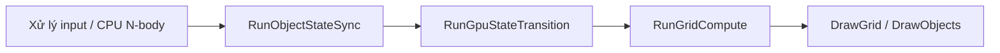

# RunObjectStateSync

## Tổng quan

`RunObjectStateSync` là giai đoạn **đồng bộ trạng thái object từ CPU lên GPU** trong mỗi frame của vòng lặp chính. Hàm gom ba bước trước đây được viết rời rạc trong `main()` thành một bước duy nhất, đặt tên theo quy ước `Run*` giống các giai đoạn khác của pipeline (`RunGpuStateTransition`, `RunGridCompute`, ...).

- **Khai báo:** `include/gravity_sim_3Dgrid_function.hpp`
- **Định nghĩa:** `src/gravity_sim_3Dgrid_function.cpp`
- **Nơi gọi:** vòng lặp chính trong `src/gravity_sim_3Dgrid.cpp`

```cpp
void RunObjectStateSync(GLFWwindow *window, size_t &objectCount);
```

## Tham số

| Tham số | Kiểu | Ý nghĩa |
| --- | --- | --- |
| `window` | `GLFWwindow *` | Cửa sổ GLFW, dùng để đọc trạng thái chuột phải khi đang tạo object mới. |
| `objectCount` | `size_t &` | Số object hiện đã được materialize trên GPU. **Truyền tham chiếu** vì hàm sẽ cập nhật giá trị này khi số object trong `objs` thay đổi. |

## Vị trí trong frame



`RunObjectStateSync` phải chạy **trước** `RunGpuStateTransition`, để các compute shader (`nbody.comp`, `integrate.comp`) và vertex shader luôn đọc dữ liệu object mới nhất, đúng với số lượng object hiện tại.

## Các bước thực hiện

Hàm thực hiện tuần tự ba bước. **Thứ tự là bắt buộc.**

### 1. Cập nhật object đang khởi tạo trên CPU — `UpdateInitializingObject(window)`

Nếu object cuối cùng trong `objs` đang ở trạng thái `initializing` (người dùng đang tạo object bằng chuột):

- Khi giữ chuột phải: tăng `mass` theo `deltaTime` và tính lại bán kính Schwarzschild `rs`.
- Luôn tính lại `radius` từ `mass` và `density`.

Bước này chỉ thay đổi dữ liệu trên CPU (`Object`), chưa chạm tới GPU.

### 2. Đồng bộ kích thước buffer — `SynchronizeObjectStateBuffers(objectCount, objs.size())`

Chỉ chạy khi `objs.size() != objectCount`, tức có object được thêm hoặc bớt:

- Cập nhật `objectCount` thành số object mới.
- `ManageObjectStateBufferCapacity`: tăng/giảm dung lượng các buffer per-object (`CurrentState`, `NextState`, `ObjectPhysical`, `ObjectDerived`, `ObjectControl`, `ObjectAcceleration`, `ObjectRender`) khi cần.
- `objectGpuState`: ghi dữ liệu ban đầu cho các object mới vào GPU, gán `gpuStateIndex` và cập nhật `LogicalCount` của các buffer.

### 3. Đẩy thuộc tính object đang khởi tạo lên GPU — `SynchronizeObjectGpuProperties(objs.size() - 1)`

Chỉ chạy khi object cuối đang `initializing`:

- So sánh `mass/density`, `radius/rs`, cờ điều khiển (`initializing`, `launched`, `target`, `id`) và `color` giữa CPU và buffer GPU đã map.
- Chỉ khi có thay đổi mới chờ GPU hoàn tất (`WaitForGpuCompletion`) rồi ghi đè phần dữ liệu khác biệt.

## Vì sao thứ tự quan trọng

| Ràng buộc | Lý do |
| --- | --- |
| Bước 1 trước bước 3 | Bước 3 upload giá trị `mass`/`radius`/`rs` do bước 1 vừa tính. Đảo thứ tự thì GPU sẽ trễ một frame. |
| Bước 2 trước bước 3 | `SynchronizeObjectGpuProperties` bỏ qua `objectIndex >= LogicalCount()`. Object vừa được thêm sẽ chỉ có slot hợp lệ sau khi bước 2 cập nhật buffer. |
| Toàn bộ hàm trước `RunGpuStateTransition` | `RunGpuStateTransition` nhận `objectCount` đã được cập nhật để dispatch đúng số work group. |

## Ví dụ sử dụng

```cpp
while (!glfwWindowShouldClose(window) && running)
{
    // ... input, CPU N-body ...

    RunObjectStateSync(window, objectCount);
    RunGpuStateTransition(nbodyShaderProgram, integrateShaderProgram, objectCount, epsilon,
                          pause);
    RunGridCompute(computeShaderProgram, objectCount);

    DrawGrid(renderingShaderProgram, gridVAO, gridIndexCount, objectColorLoc);
    DrawObjects(objectRenderingShaderProgram, objs);
    // ...
}
```

## Ghi chú

- Các hàm con (`UpdateInitializingObject`, `SynchronizeObjectStateBuffers`, `SynchronizeObjectGpuProperties`) vẫn được giữ public. Ví dụ, `gravity_sim_3Dgrid_phase2_validation.cpp` gọi trực tiếp `SynchronizeObjectStateBuffers`.
- Hàm không phát sinh chi phí đồng bộ GPU nếu không có thay đổi. Bước 2 chỉ chạy khi số object đổi; bước 3 chỉ ghi khi dữ liệu thực sự khác.
- Xem thêm mô hình buffer và binding trong [gpu_memory_manager.md](gpu_memory_manager.md).
